# Sofix illustrated user manual

27 October: Home splits the right column into the round's table and **Rewards** for the selected Sorare GW. You and
Sofix show probability-weighted expected rewards beside checked actual rewards (Sofix: **Would win**). Cash, each
essence competition/rarity, cards and XP remain separate. A dash means unavailable or pending; an actual zero is a checked zero.
A `+` marks a partial total, with checked-lineup coverage below. Your existing lineup read updates both sections.

26 October: automatic reward checks also re-evaluate older unfinished deadlines using the games represented in your entered and recommended lineups, including the bench. Checks start one hour after the job first observes all relevant games finished; scheduled-run delays can add time. Completed results keep their correction schedule. New saved rewards become visible after scheduled publication.

26 October: Gallery uses larger cards with a coloured score and FDR on the art, then start chance, fixture crests and xD. Its information icon reveals L5/L10/L40, all saved start sources and lineup rewards. Pages hold twelve cards; filtering resets the page and player links reveal the right card. Read/refresh actions across Home, Play, Missions, Lineups, Arcade and Control use named icons; hover shows their purpose, with loading, failure and cooldown messages retained.

11 October update: Lineups now has **Actual**, which loads Sorare's announced starting XI and bench for the selected
match without opening Sorare. An unannounced or unreadable XI stays empty with its reason. Missions rebuilds missing
legacy references from pre-day stats, labels them **Reconstructed**, and includes their settled results in your comparison.
When historical eligibility is incomplete, the comparison is provisional against the cards recorded that day;
the Audit keeps measuring captured forecasts. Mission plans allocate any supported positive chance to Essence first,
then clues, then XP. Best cards remains independent for each mission. Loading missions saves Sofix's choices and their
chances for that task: Recap, Missions and later refreshes retain them even after the players have played. Further
Sorare reads update your picks and verdicts without replacing Sofix's saved choices.

**Edition:** 2026-09-28 · **Audience:** the Sofix owner · **Scope:** web app, PWA, Control Center and Chrome extension.

The screenshots in this manual use the repository's deterministic demo fixture, and the extension shots use a
recorded 24 September review payload. They demonstrate layout and meaning—not live recommendations, balances,
prices or standings. Live pages always show their own sync/freshness state.

## Premier League, Bundesliga and Ligue 1 FDR (22 October 2026)

On Season/Fixtures, Difficulty and Table, **Competition** selects LaLiga, Premier League, Bundesliga or Ligue 1. Switching leagues keeps the date window; the league's GW number can differ. Team links and reloads retain that league. A week without games stays empty. Refresh runs automatically with the existing job, including when your computer is off.

The new leagues have independent football ratings, expected points/goals and raw clean-sheet chances. Their historical Record uses their own league history. Live Odds/Vs odds and a frozen preseason projection are not supplied for these leagues; missing numbers stay blank. A finished game shows only the forecast actually saved before kickoff, so the first refresh does not invent historical forecasts. The Bundesliga and Ligue 1's 16th place is a relegation play-off place; the bottom two go down directly.

## Champions League and Europa League (23 October 2026)

Competition also selects Champions League or Europa League on Fixtures, Difficulty, Table and Players.
Each covers all 36 current main-stage clubs automatically. Qualifying rounds are outside this release;
knockout fixtures appear when their actual draw and dates are published. FDR covers regulation time,
including neutral venues. There are no invented match odds or reconstructed preseason forecasts.

The table counts the league phase only: 1–8 reach the round of 16, 9–24 the knockout play-off,
25–36 are eliminated. Actual uses results up to the selected GW; Expected adds the remaining validated
forecasts to points already won. Chances simulate independent results and use expected goal difference
for simulated ties. Actual unresolved discipline/coefficient ties remain shared.

CL and EL use their own validated FDR-based player models. A mixed week selects the model of each actual
match. Own-score history uses final, authentic main-stage starts in all three UEFA competitions, available
before the lock. Reviewing scores remain pending. A player with no source position remains searchable as
Position TBC, without an invented score. Numbers belong to the selected Sorare GW and expire with the
existing forecast freshness rules. A week with only domestic games receives no invented European match.

Conference FDR and xScore did not pass the held-out release gates and remain unavailable. Its factual
results are retained in the validated pooled football history; they do not authorize Conference forecasts.

## 1. First use

Open Sofix in Chrome or Edge. The app is private and protected by the deployment login. Use the header to move
between Play, Lineups, Fixtures, Difficulty, Table, Audit, Cards and Players. The Sofix wordmark returns home.

The week control on the right is app-wide, a strip with no menu to open: the week shown, **GW24 20–23 Oct** (on a phone just
**GW24**), with its neighbours as numbers either side (grey played, blue the next one, **R12** a LaLiga round Sorare has not opened).
Click a number to go there; swipe or scroll the strip for the rest of the season; hover a number for its full name and dates.

- left/right arrows move one available week;
- the target icon returns to the week the app opens on;
- the dot beside the week shown is green while it is being played, blue when it is the next one.

The app opens on the week being played until its games are over: at 00:00 Madrid the day after its last game it moves to the next
one, even though Sorare keeps the week open to the next lock (a round ending Monday hands over on Tuesday at 00:00, not at the
Tuesday 16:00 lock). A Sorare-only week (Europe, national teams) hands over at 00:00 on the day its window closes.

The sun/moon button at the top right of the bar switches between the light and the dark theme. The choice is kept in
this browser; until one is made, Sofix follows the system's light or dark setting. The magnifier beside it searches players by
name (accents ignored) and opens his page. Every Sorare card drawn anywhere in the app opens that player's page too.

A week has one name on every page, in the bar, in the Play title and on Lineups and Home, because the two leagues count their
weeks differently (LaLiga's round 8 is Sorare's GW21): **LaLiga round 8 · Sorare GW21**; before Sorare opens the week
**LaLiga round 9 · Sorare not open**; an international break has no LaLiga round, **Sorare GW19 · national teams**.

How fresh something is reads the same everywhere (Home, Play, Lineups, Control, the status pill, the sorare.com overlay): how long
ago and the time it was made in Madrid, **9 h ago (03:33)**; once it is over a day old the day is added, **2 days ago (Tue 03:33)**.

Each page lists the weeks it can show: the LaLiga pages list LaLiga rounds; **Play** lists every Sorare gameweek
once (one that covers a weekend and a midweek round is one row), plus every LaLiga week still to come that Sorare
hasn't opened yet, marked **Sorare opens later**, or **early plan** when the job has planned it. A week with nothing to
show says so instead of showing another gameweek.

The selected week lives in the URL (`?gw=` for LaLiga-oriented pages and the shared week mapping behind `?w=` for
the combined calendar), so a bookmark preserves the view. LaLiga and Sorare gameweek numbers are separate systems;
the date range is the reliable common reference.

### Install as an app

Open **Control** from the circular status control, then use **Get the app**:

1. Desktop Chrome/Edge: choose the install icon at the end of the address bar.
2. Phone: scan the QR code, open the private site, then choose **Add to Home Screen**.
3. Keep the same private deployment login. Installation does not create another account or background service.

The PWA is a windowed shortcut to the same cached app. It is not an offline database; stale/failed source states
remain visible rather than being invented locally.

## 2. Recap (home) — this gameweek at a glance

The Recap is about the week in the top bar (since 5 Oct 2026; design canvas board 1). From the top:

- **Header**: the Sorare gameweek, its LaLiga round and days, when it locks ("Locks Fri 16:00, in 4 days") and **Open the plan**.
- **Best cards**: your ten best cards of the week by xScore, all positions together, each with its xScore in a hexagon of Sorare's
  colour, his first game and his chance to start (whose number it is on hover).
- **Your season**: choose a season to see Limited essence, cash, card rewards and distinct GWs with entered lineups.
  **Week by week** shows rewarded GWs only; expand one to see its actual essence-winning lineups and captains.
  Zero-reward GWs still count as played. Open Home in Chrome with a signed-in Sorare tab to save missing finished
  weeks; failed reads can be retried. Saved lineups and rewards also work on your phone without the extension.
- **This round** (and **The N games** on Fixtures, which adds the bookmakers' odds): one row per match. Each side's name carries its
  own expected goals (xG), expected decisives (xD: its xG times the club's decisive actions per goal this season, from
  `backend/artifacts/team_decisives.json`; rebuild with `python -m app.sorare.team_decisives` after the games export) and clean-sheet chance under it; between them one bar of win, draw and win (Sorare's colours) with
  both-score under it. The favourite is in bold; a played match shows its score. On a phone the bar goes first, the sides below.
- **Table after round N**: the table once the round is played as expected: points now, points after and places gained or lost.
- **Your lineups**: every entered lineup, followed by every lineup of the best Sofix plan. Each compares expected team
  xScore with the actual score; missing scores stay blank, and partial plan results say **Actual so far**. The best plan
  has the highest expected essence. Under each card the big hexagon is what he scored on Sorare, a grey "-" until he has
  played (or when he did not; the hover says which), and the small hexagon beside it is his xScore, on Home and Play alike. The big
  hexagon is his own score, before the card's and the captain's bonuses. Hover a card (tap it on a phone) and the hexagons open into a
  honeycomb: the card's total with those bonuses (your entered lineups, once his own score is in), his xD, his score and his xScore.
  A plan row is the cards (larger, the captain marked, the bench after a divider), xScore,
  the actual score, xD (the starters expected to bring a decisive action: each one's chance from his game when Sofix works it
  out, else his real record: how often his own read starts brought one, nothing added; a player with no read start has none and the
  lineup then shows a dash; with two games in the week it is his better game's, never both added up). Each card shows its own xD under its xScore, and a player's page shows his next to his start chance
  and one reward chance. Its round **i** button opens the rest: the chance of XP, essence, cash and a card apart, every
  reward level with the score it took and its chance, the expected range, the managers entered and the format.
  Entered teams and Sofix teams share the same comparison rows. Until the week ends an entered team also shows its
  reward chance: the plan's own when it is a plan lineup, else an estimate of reaching the score the lowest paid level
  took (none for a Room); Play's entered rows show the same chance as a dial. Older saved teams use their retained appearance
  order with that GW's saved forecasts and rules for an estimate. Reviewing/live player results count toward the
  plan's **Actual so far**; pending games stay unknown until scored or confirmed DNP.
- **Missions**: today's open missions and the three cards of yours that fit each best, with the chance (the Missions page's numbers).
- **News this week**: your players hurt or banned in the last seven days and those cleared to play after a knock, in Futbol Fantasy's
  words in English with the date and their chance to start. A long-standing injury is not news; the Lineups page keeps every note.

The header also says whose Sorare account it reads and when it was synced. **Your lineups** opens with what you entered on
Sorare (read through the extension), then all of the best plan's lineups. The app opens on the current GW until its end,
even while Sorare is already planning the next GW; explicit selected-week links still work. **Team news** sits beside **News this week**: how your
plan's players look for the round, who might not start and what moved since yesterday, or why Futbol Fantasy has said
nothing yet. The old Sorare row is gone from the home: the plan and the week just played are on the Sorare page, and the
collection (with its "No Rare goalkeeper" warning) is in the Gallery.

Every player card grows a little when you point at it (a spring, a shadow and a light sweep). In-season cards and
competitions carry a star, Classic ones a clock.

Each colour of a number is Sorare's own score band for it: up to 20 red, 21 to 35 orange, 36 to 50 yellow, 51 to 60 lime, 61 to 75
green, 76 and above cyan.

When a selected Sorare week has no LaLiga round, Home replaces the LaLiga strip/tiles with **No LaLiga this week**
(one strip: how many games your players have, per competition and per day, and an **Every game** link to the
full list on Fixtures; 14 Oct 2026). It does not silently show the next league round.

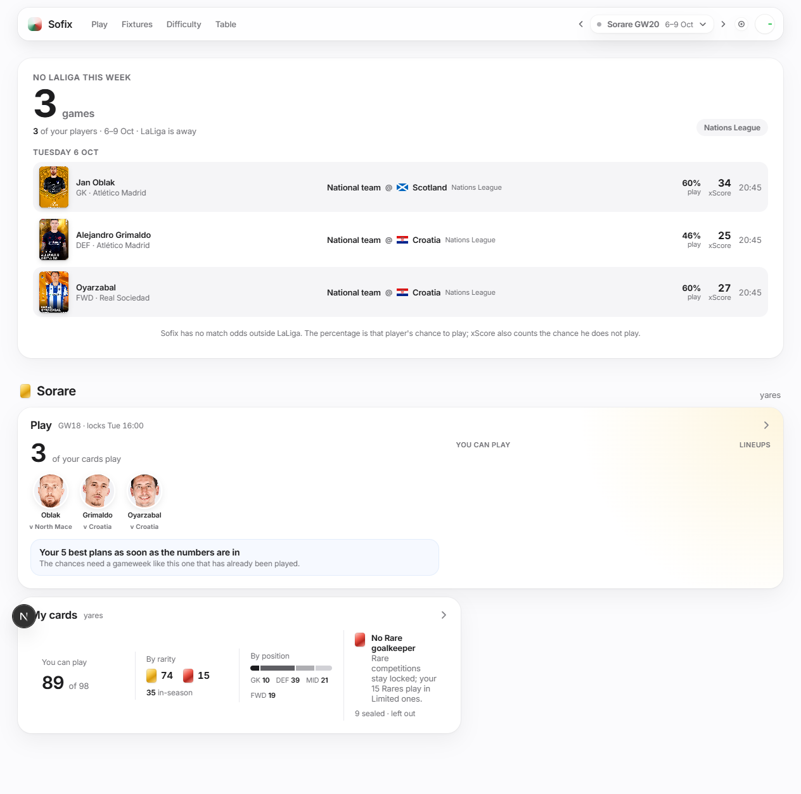

## 3. Fixtures

The LaLiga view (This week → LaLiga) opens on the round as a scoreboard: each match on two rows with each side's
chance to win, expected goals and clean-sheet chance, plus the draw and both-score chances; beside it, the table
after the round. The plain list of fixtures and results by day follows.

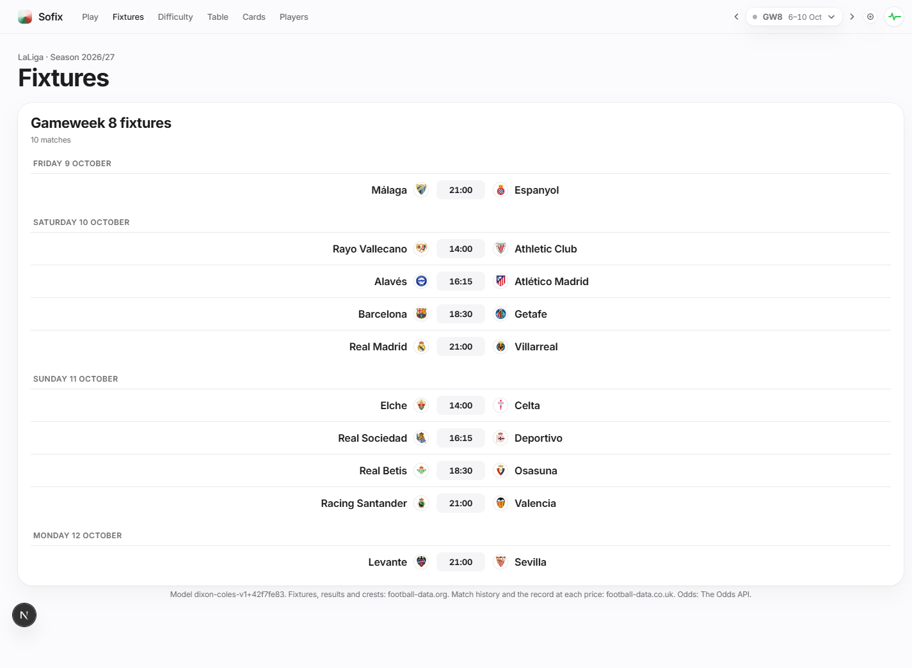

Fixtures is the plain schedule for the selected LaLiga GW. Each row contains kickoff in `Europe/Madrid`, home/away
clubs, status or score, and the pre-match outlook. “Date TBC” means football-data.org has not assigned a kickoff.

For a future match, use the probability/price context as a forecast, not as a certainty. For a finished match, the
stored forecast stays attached so the result can be reviewed honestly. Changing the header week changes this list,
the difficulty overview and the current-table cutoff together.

## 4. Difficulty

The competition icons sit on the right of the hero. **All** combines the four domestic leagues and the three European
competitions in Madrid calendar weeks, merging each club's games into one row. It ranks up to 40 clubs for the chosen
window and lens, ten per page. Every game in a double week stays visible. Expected points fills the standings card's
space; club links open their original competition. Missing competitions are named above the board.

Season → Fixtures (`/season`) shows the week picked in the top bar (the week you're in by default): its LaLiga round, if it
has one, and the Champions, Europa and Conference League games of clubs holding one of your players, each European match tagged
with its competition. A week with no round shows no round; a strip of round numbers switches to any round. Difficulty colours use Sorare's score bands: cyan for the
easiest games, then green, yellow, orange and red for the hardest.

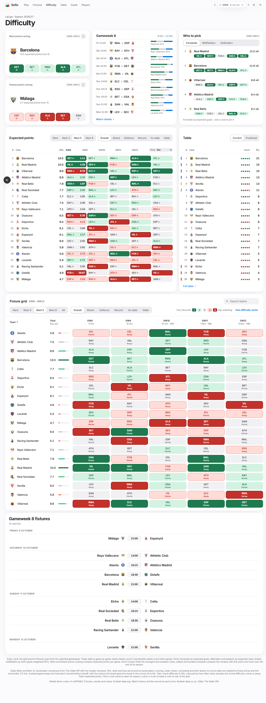

Difficulty is the main football-planning page. It contains:

1. **Kindest/toughest run** — per-game comparison for the chosen horizon.
2. **This GW** — the selected matches.
3. **Who to pick** — forwards by expected goals, defenders/keepers by clean-sheet chance, midfielders by a 65/35
   attack/defence blend.
4. **All-club ranking beside the current table** — row-aligned, with xPts as a number rather than a decorative bar.
5. **Full fixture grid** and the selected GW's fixture list.

### Horizon

**Next** shows the selected gameweek as match cards. **Next 3/5/8** aggregates future games from that week. Finished
fixtures remain visible for review but do not inflate future totals.

### Six lenses

| Lens | Tile answers | Ranking total answers |
|---|---|---|
| Overall | How likely is the club to get a result? | Expected points across future games |
| Attack | How many goals should it score? | Expected goals across future games |
| Defence | How likely is a clean sheet? | Expected clean sheets across future games |
| Record | How has this club historically done at this model price? | Average actual points in comparable price bands |
| Vs odds | How has it historically done at this bookmaker price? | Average actual points in comparable market bands |
| Odds | What is the fair bookmaker win chance? | Market expected points per priced future game |

Record and Vs odds are descriptive checks, not hidden inputs to the forecast. They use five seasons, require at least
five club matches and shrink toward an eight-game prior. Odds totals are averaged per priced future match so a club
with an extra priced game is not automatically favoured.

### Colours and labels

Lower difficulty is kinder. The five spoken labels are **Very favourite**, **Favourite**, **Even**, **Underdog** and
**Big underdog**. Tiles show colour, opponent and venue; bucket numbers deliberately stay in tooltips/screen-reader
text. Buckets 4–5 also receive a visible ring. The top cutoff is stricter away than at home.

### Price menu

For multi-week Record/Vs odds cards, choose which price/result statistic appears: W/D/L, scoring/two-plus goals,
clean sheet or conceding two-plus. Fair odds are `1 / probability`. Market-derived scoring and clean-sheet numbers
are fitted from fair 1X2 plus totals prices; they are implied probabilities, not direct bookmaker markets.

## 5. Table

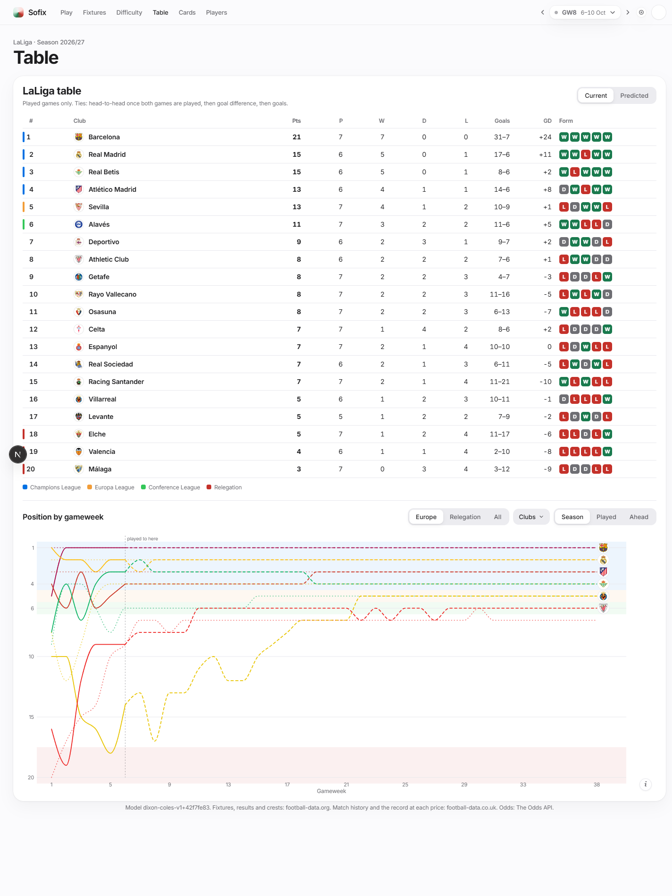

Season → Table has three switches, all kept in the address. **Actual / Expected / Predicted** (`?tm=`): Actual is the
real table alone, with no forecasts; Expected plays every game,
played or not, at the strength the model gives each club today (it is refitted after every result, so a club that
loses eight in a row drops and climbs back when it wins); Predicted is the same at the strength the model gave each
club before the season, saved once and never changed. **Total / Home / Away** (`?v=`) counts only those games in the
table and xPts; the chances stay those of the full league table. **Season end / After GW N** (`?t=after`, Predicted
only) stops the chances at the week's round. Expected and Predicted show xPts, xGD and the chances of the title, UCL
(top four), UEL (fifth), UECLQ (sixth, the Conference League play-off) and relegation. Every reading then shows
**xD per game**: the club's positive decisive actions per game in Sorare's stats of every LaLiga game it has (all
games, whatever the split) by kind: **Att** goals, assists, penalties won; **Def** clearances off the line, last-man
tackles; **GK** penalties saved and the keeper's clean sheets (an hour played). Last comes the next opponent's crest
(name, venue and kickoff on hover and for screen readers) with its difficulty (FDR).

The left/current table stops after the selected LaLiga GW. Its ordering applies LaLiga head-to-head only after both
mutual matches have been played, then goal difference and goals scored. Early in a season, that can differ from a
site that provisionally uses goal difference for unresolved ties.

The predicted table combines played points with expected future points and seeded season simulations. Identical
input always produces identical title/Europe/relegation percentages. It is a model projection, not the official
table and not a live betting price. The preseason opening projection is fixed so later views do not rewrite what
Sofix believed before the season.

## 6. Team page

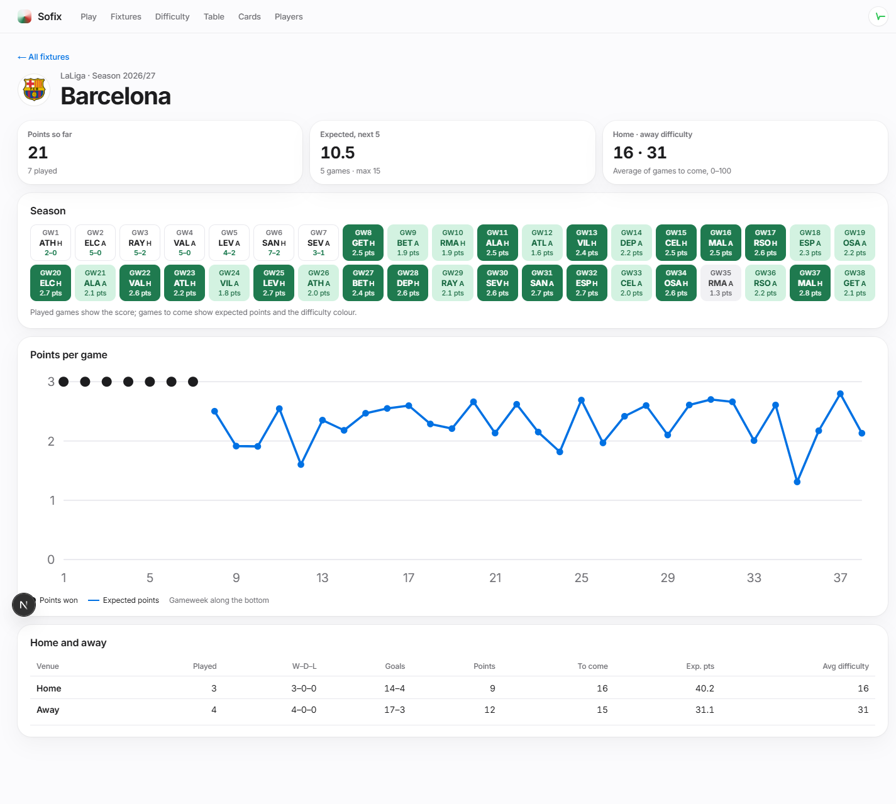

Open a club from a table, fixture or grid. The team page gathers its selected-week match, upcoming run, lens values,
results/form and table context. Use it when the grid's compact tile is not enough. The same global week and model
definitions apply; the page does not run a separate club model.

## 7. Play — Sorare planner

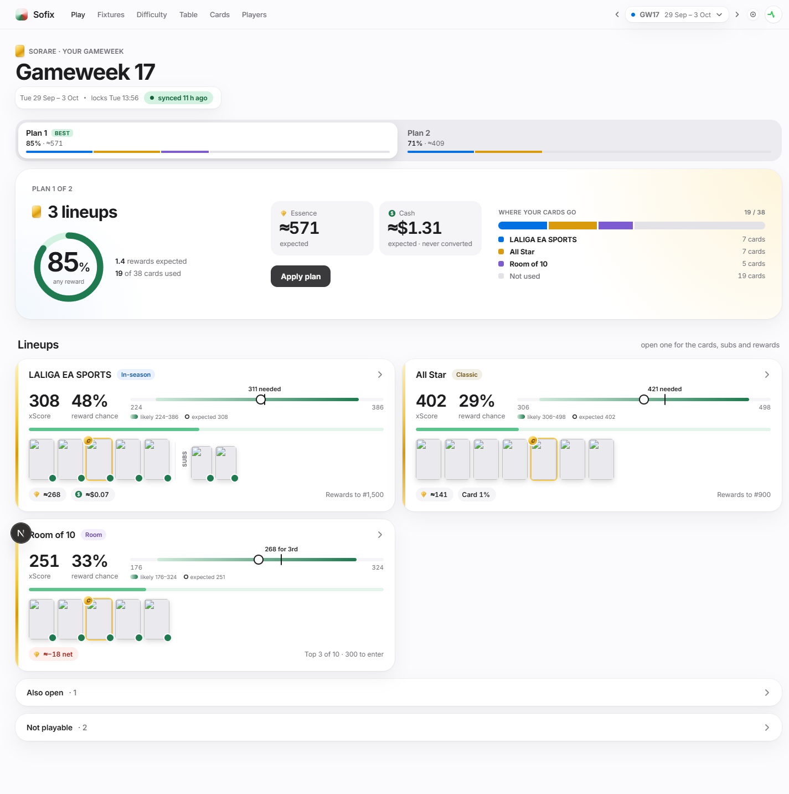

Play shows one recommended whole-GW plan for the selected Sorare gameweek: the saved Sofix plan with the highest expected essence, with published order breaking ties. It is built from the synced collection, competition rules, pre-lock forecasts and reward cutoffs. Your actual entered lineups appear above the recommendation, including weeks without a saved plan.

The header compares **You** with **Sofix** for the selected GW, with real card previews and the same three measures on both sides: **expected paid lineups**, **no-reward risk per lineup** and **average projected points**. Expected paid lineups add each entered team's chance of cash, essence or a card; XP alone is excluded. For example, four teams with a 25% chance each expect one paid lineup. The risk figure is the average chance of an individual team missing a paid reward, not the chance the entire portfolio wins nothing. Drafts stay in the lineup list but do not enter these figures. When a forecast is missing, the figures show the available cohort and its denominator; a fully unavailable cohort remains a dash. Custom estimates and saved reads retain their labels; finished GWs identify the figures as recorded before kickoff.

Each side shows **Projected** rewards alongside **Won** (your entries) or **Would have won** (Sofix’s unentered recommendation). Projected rewards add the real prize tier reached by each lineup’s projected points: cash, each essence currency/rarity, cards and XP remain separate. Zero winnings are hidden. Hover, focus or tap a projected amount or **Other prize possibilities** to see each lineup’s other prize tiers and their chances. These are real attainable prizes; the former fractional averages such as $0.21 or 29 essence are no longer displayed. Pending actuals retain checked coverage, and `+` on a positive actual amount means more lineups remain unchecked. Once locked, the recommendation uses the same exact pre-lock lineup set as its reward check. Missing forecast coverage is labelled explicitly and does not suppress the available points/risk cohort.

Once the GW locks, the points figure becomes **pts / lineup so far** (yours from Sorare's lineup scores, Sofix's from the scores the job reads) with the projection kept beneath it, and the reward column becomes **So far**: each lineup's checked reward, or until it is checked the real prize tier its score so far reaches (Rooms wait for their ranking). The projected column never changes. The numbers move with each reload after a score check or an extension read; the page does not poll. Each entered lineup row repeats it for that lineup: **Projected** (the prize its projected points reach) and, once locked, **So far** (the prize its score so far reaches) or **Won** (the checked reward, or what Sorare paid); the row then names only its rank unless Sorare has paid something. After the lock **Expected paid lineups** becomes **Paid so far** (lineups whose prize so far is essence or better), the second figure is the chance of **essence or better** per lineup (cash, essence or a card), and the cards drawn are every card of the lineup with the biggest prize (cash, then cards, then essence, then XP; more points break a tie), projected before the lock.

The existing half-hourly score job now checks rewards automatically, without an open browser. It observes the last relevant game finished, waits one hour, retries unpublished rankings/rewards and checks corrections a day later. Sorare has no final-whistle timestamp, so the clock starts at the job's first observation (up to a half-hour later than the source's update). Starters and substitutes on both sides are covered; incomplete identity coverage falls back to the full GW's games. Received classic rewards come from Sorare's rankings; saved Pro lineups use their task's success/failure state and actual reward multiplier. Sofix is scored with its frozen rules against that GW's real reward cutoffs, or its saved Pro step; it is never labelled a paid receipt. Missing cutoffs, unranked teams or unavailable rewards remain pending. Each side shows checked coverage and its next check time when available.

**Your lineups** jumps to your actual entries; **Apply plan** retains Check, Draft and explicit Enter. **Other plans & strategies** opens **Audit > Strategies > Plans** for the same GW, where the detailed likelihood/allocation facts and Sofix/Sorare/strategy and plan switches remain available. **Results** keeps the strategy podium and three comparison charts; **Recommended plan** returns to Play for that GW. Existing bookmarked plan/source/hindsight links redirect to their equivalent Plans view. The recommendation shows where the cards go and the lineups as the same rows as the Recap (14 Oct
2026): competition with its kind and format, its cards with each one's xScore in Sorare's colours (its score after the games),
xScore, actual and xD, and one reward chance (Paid or No reward after the games); once the week has locked, each card shows
his score as soon as his game is in and the lineup its **Actual so far**, as your entered lineups do (15 Oct 2026); each row, and its **i**, opens its sheet with the
range, the score needed and every reward level. A free competition is filled with every team your cards can make, however small the chance (13 Oct 2026): the teams with a real
chance take their cards and substitutes first. In a European week Sorare's own competitions (European Champions, European
Contenders) are planned too, for the players with a game in them. A player's start chance is Futbol Fantasy's, else the one
Sorare's page showed in your browser (the extension saves it), else Sofix's from his form. Lineups under 5% sit under **Long shots**; this opens immediately when they are the only available
lineups. A locked/live GW retains its recorded pre-lock plan, including on Home, rather than showing the next GW's plan.

**Sofix or Sorare (25 Oct 2026).** In Audit > Strategies > Plans there are two sets of plans: **Sofix** builds them on Sofix's
xScore, **Sorare** on Sorare's own projections (game by game, read for that week's games). Both use the same cards,
competitions and chances of starting; only the expected score differs, so you can compare them, and the Audit scores both.
Until Sorare publishes its projections (about two days before the lock) the Sorare view says when they are due.

**Strategy alternatives (25 Oct 2026).** In Audit > Strategies > Plans, beside Sofix and Sorare, three more buttons plan the same week another way: **Keeper with defender**
(each lineup has a defender of the keeper's own club: nothing, or win big), **3 from 1 club**, and **Highest ceiling** (each player at the
top of his range). The same cards, competitions and chances of starting; the starters are chosen the strategy's way, and every lineup is
then priced on Sofix's own numbers, so its team score, range and reward chance mean the same as in the Sofix plan. Each has one plan, made
by a lighter search, written down with each refresh until the lock. They are a second look, not a recommendation: the replay
([backtesting](backtesting.md)) finds none of them beating the Sofix plan on points, and Audit > Strategies scores them against what
really happens.

**Essence preference.** Under the lineups, **Essence preference** lists the preferred essence order: LaLiga, then Champion, then
All Star unless you change it (↑ ↓, then **Save and replan**, which starts a refresh; the plans follow it about six minutes
later). Sofix prioritizes the expected reward, essence plus cash with $1 counted as 300 essence (20 Oct 2026: $5 beats 1,000
essence, 2,000 essence beats $5), with your essence preference and reward chance breaking ties.
**Best** marks the plan with the highest expected essence in each source, using published order for ties. Play opens that Sofix recommendation. Saved alternatives stay tied to their exact GW; a missing source is labelled rather than replaced by another source. Finished GWs keep their available before-lock/after-games views in Plans.

**Pro in the plan (20 Oct 2026).** Your Pro boards (steps, targets, prizes) are read from Sorare's public API each refresh, no
extension needed. Every board (each league's, Europe's, Contenders) is the competition its current step is, from that step's own
rules: the competitions its players come from, the rarities, the slots, four in-season cards where it gives the season bonus, the
level and captain bonuses; no substitutes, one lineup, paid all or nothing when the lineup reaches the target, the prize raised by
Sorare's Rare Reward Bonus. A board with a rule Sofix cannot check (the Inferno boards' card editions) is left out. A lineup that
misses its target sends the board back to step 0 (20 Oct 2026), so a Pro lineup is built from games that all start within an hour
(20 Oct 2026): every teamsheet is out before its first kickoff, and it is entered only if all five start. The planner gives each
lineup's cards to Pro or elsewhere, whichever is worth more. A Pro lineup reads "Step 0 · needs 320 · 500 essence" and "Games
Thu 18:30–19:00 · enter once the teams are out"; Pro and Arena lineups say where the same five are worth more ("Worth more here
than in LaLiga Arena", or "Worth more in LaLiga Pro"); the sheet gives the chance all five start, both chances, and the **Pro
board**, the steps ahead with this lineup's chance of each target if all five start. Limits: only this week's step is valued (the
next ones only shown), one try a week. Apply leaves Pro out: enter it on Sorare. **Load from Sorare** (20 Oct 2026), under each Pro
lineup, reads the announced elevens of the games in the next three hours (no extension, works from a phone) and rebuilds the plan's
Pro lineups on them in about a minute: an announced starter starts, a benched player only fills a slot no starter of yours fits or if
his chance of coming on times his score if he does is at least the best starter's; anyone else does not play. The rebuild sits under
Sofix's lineup, "Rebuilt at 18:12", with the swaps named ("Pedri not in the eleven → Gavi"); the plan is never replaced. To enter
it, open that row in the dock on sorare.com and press **Guide me · rebuilt** (extension 0.4.2). It also works on a locked gameweek
still being played, for a Pro lineup none of whose players has kicked off, and from the dock (0.4.3). While the gameweek is the one being
played, today's missions sit under the lineups with the cards that fit each (chance, opponent, kick-off and what he
did over his last 5); the full Missions page is one click away.

Above the recommended Sofix plan, **Your Sorare lineups** shows what the signed-in owner actually put on Sorare for this exact GW. Entered
lineups and drafts are labelled separately and retain their Sorare competition and card list. Each one is drawn as the Recap's
row (14 Oct 2026): the cards with their xScore under each (their score once they have points), xScore and actual, the reward
chance while the week is on, the result. This is not Sofix's
suggested plan: the extension reads the selected Sorare fixture directly, so the block also works for timeline weeks
that Sofix no longer retains as an optimized plan. Your Pro lineups sit with them (extension 0.3.18, 15 Oct 2026, every Pro board, LaLiga or not; if none shows, the line above the lineups says why): each one whose
matchday starts inside the GW, named after its Pro board, with "Step 3 · needs 280" (and "cleared" once Sorare's score reaches it)
in place of a rank. They are only read here; the plan's own Pro lineup is in the recommendation below ([plans/pro.md](../plans/pro.md)). Every successful read is saved, including live scores and drafts.
Reopening Recap or Play shows that GW's last saved read immediately and checks Sorare in the background. Saved teams
also work on a phone or with Sorare closed; an unavailable refresh keeps them visible with a status message. A signed-in
`sorare.com` tab is needed only for a new read. Live snapshots stay separate from final reward archives. Lineups from
another GW are never carried into the selected one.

Each row compares **xScore** and **Actual**. Matching saved Sofix lineups retain their recorded forecast. Custom lineups
get an **xScore estimate** using this GW's player forecasts, original slots, captain, bonuses and substitutes, with
independent playing chances. A Pro lineup (Sorare sends no bonus rules for it) prices each card with that board's
in-season and level bonuses, so cards Sofix placed on another board still count. Missing inputs say **Forecast unavailable**, never zero. Custom estimates require extension
0.3.13 (reload once in `chrome://extensions`). Older saved teams are enriched automatically when opened with Sorare
available, without changing saved scores or rewards. Saved metadata remains available after the Sorare tab closes.

Once Sorare has scored a lineup, its row shows the **actual score** (large), then **where it ranked and what it was paid**
("Rank 1,204 · $2.50 · 250 essence", or "no reward paid" once it is ranked and nothing was), and each card carries its
own score with a **C** on the captain. Before the lock the row says "Locks in 1 d 3 h" instead of a 0, between the lock and the
first game it says "Not started", and once the games are on and it has no rank yet it says "Still scoring". This needs the
extension at version 0.2.2 or later (reload it in `chrome://extensions`); an older one still shows the lineups, without
their results. Essence counts Limited essence only, as the plans do.

Read each lineup from left to right:

- competition and lock state;
- cards/slots, captain and substitutes;
- each card's **xScore**, the same number as on Lineups and Players: his score if he starts, or if he comes on when he is
  under 40% to start, with whose number it is (SF Sofix, SO Sorare, L5 his last five); the team score below counts the
  chance of not playing;
- an expected range, not a guarantee;
- reward probability and the cutoff evidence behind it;
- what its first level pays and the score that reached it ("250 at 311+").

**A reward is all or nothing.** A lineup that reaches a level gets that level's reward whole; one that does not gets
nothing. Play never shows a share of a reward. A lineup's sheet lists every level under **Rewards**: the score that reached
it in the week the chances come from ("311+ · #301–1,500"), what it pays, and the chance of scoring at least that, so the
first level's chance is the lineup's reward chance. A Room lists its places instead. **XP** levels (500 to 1,000 XP for
LaLiga ranks 1,501 to 3,500, Room places 4 and 5) are listed and given their own chance, but XP never counts as being paid.
A Room's entry fee is shown as "300 to enter", but no plan enters a Room that charges a fee (All Star Cap 260, 13 Oct). An All
Star lineup is built last: it only gets the cards LaLiga and Champion could not use, and where it is the only competition open it is
entered all the same.
No lineup starts a player who is under 30% likely to play (13 Oct): a keeper at 5 to 20% is a zero the lineup cannot make up, so his cards
are left for other lineups or the bench.
A player outside LaLiga (Bundesliga, Premier League, Segunda) has his own league's games counted for "will he start?": a regular is no
longer left at the 40% a player with no record gets.

In a lineup's sheet, a card's name opens his match on **Lineups** (Futbol Fantasy's probable elevens and the chance of each player of his
side). A game Futbol Fantasy has no page for, such as a national-team game, has no link.

**Scores** (This week) is the same page for games played: the eleven that started, each card with what he scored. **Sofix** and
**Sorare** swap that for what each expected of him. The other side of the comparison sits in small under the main number: both
expected scores (SF Sofix, SO Sorare) under the real one, the real one under an expected score. A score is a filled pill, an
expected score the same pill outlined. The bench is drawn as cards too, whoever scored most first. Under each team, the accuracy of each source is
100 minus the average gap in points between what it expected and what the players who played scored.

The planner enforces the published slots, caps, in-season minimum, club/card/player uniqueness, bonuses and substitute
rules. A substitute is kept only when its expected protection exceeds the bonus sacrificed by using it. It repeats a
seeded, slightly randomized whole-gameweek search and returns up to five plans whose card sets are materially different.
Plans maximize the **expected reward**, essence plus cash at $1 = 300 essence (20 Oct 2026; essence alone from 11 Oct);
essence preference and reward chance break ties.
The chances come from one simulation of the
whole plan, so two lineups holding the same players or the same game rise and fall together instead of being counted as if
apart. A plan's **most likely result** is its likeliest winnings for the week, with its chance; it is often nothing even when
some reward is likely, because the ways of winning are split over many amounts. Cash and essence are shown apart.
**Also open** gives each competition left out its reward chance and its entry fee.

### xScore

A card's xScore is his score if he starts (or comes on, under 40% to start). In the Sofix plan it is Sofix's own number where
the game model can make one (every game of his week a LaLiga game it knows), else Sorare's projection for that game, else his
last five games; the card's mark says which. The team score is the expected total: each card's score times its chance of
playing, with the bonuses. Both numbers, Sorare's and Sofix's, are written down for every LaLiga player before each lock
(`score_record:<week>`), so the Audit can say who was closer.

### Predicted vs actual

After a gameweek, Play compares recorded pre-lock player/lineup ranges with actual submitted-lineup scores. A replay
is meaningful only when the forecast was stored before lock. Actuals do not retroactively change the old forecast.

Choose **After the games** on a played week: each plan shows what it won against what it was expected to win (the
expected numbers are a replay, built from form as it stood before the lock, not the Sorare-informed plan you saw then).
The last tab, **In hindsight**, is the best way to have spread your cards over that week's competitions knowing every
score: the most Sofix found it could have won, against the scores that really paid that week. It is the best result of a
search, not a proven maximum, so one of your own lineups can occasionally beat it. It uses the cards you own today, leaves
Rooms out (a Room depends on nine other managers' lineups), and never names an expected number, because there is none.

A LaLiga round Sorare has not opened yet (LaLiga GW36 in May, say) opens as an **early plan**: a plain note says so,
and it is built from the LaLiga calendar for your cards' games, their recent form and the LaLiga competitions Sorare is
going to open, with one plan and no Apply button. Those competitions are copied from the latest finished gameweek of the same
kind (five or more LaLiga games, or fewer; the week and its rewards are named), and each lineup says **Expected** until Sorare
lists the real ones. It is a first guess: your cards as they are today, no start odds, and competitions Sorare may change. It moves each refresh, and Sorare's own numbers replace it when the week opens. The one
round that already has a lineup on Futbol Fantasy (each club's next LaLiga game, round 8 in the October break) uses
Futbol Fantasy's chance to start instead of Sofix's guess, with its **FF** mark, and a player it has out or suspended is in
no lineup. Rounds after it have no Futbol Fantasy yet and keep the guess. The early-plan note also says that, built on form,
later weeks look alike until Sorare opens them.

A gameweek Sorare **has** opened can still lack its LaLiga competitions for a while. Then the same expected competitions are added
beside the official ones: the plan shares your cards across both, each expected lineup says "Expected · Sorare has not opened it
yet", a banner above the plan says which finished week they were copied from, and Apply leaves them out (Check, Draft and Enter only
work for competitions Sorare lists). The Home says how many lineups are expected.
The day Sorare lists the real competitions, the next refresh shows only those.

Every gameweek is **kept** once its scores are final (a day after it ends, and once everything it was built from could
be read from Sorare) and stays in the week strip with its replay and hindsight, however old. A week played before Sofix started
keeping them says **not recorded** on its page; it still opens, to the lineups you entered and what they won, read from Sorare.

A week Sofix holds no plan for says why, and still shows your lineups for it: one being played is locked, so there is
nothing left to plan; one further off than the next three Sorare gameweeks gets its plan once it is one of them.

## 7a. Lineups — who starts

Futbol Fantasy's probable elevens for every match it has published (FF covers each team's next game only, so the page is not
tied to the week in the top bar). One timeline holds the round's matches: a column for each day (Fri 9, Sat 10…), each kickoff time written once on a rail, and a match as
its two crests, home side first, under its time. Two games played together share one time. The open match is the black pair and its time
is darker; hover a pair for the club names. The page opens on the next match. On a phone the timeline scrolls sideways and keeps the open
match in the middle. Competition and round tabs appear only when the page holds more than one. Picking a match, a round or a
competition changes the page at once, from what it already holds (all the round's matches arrive with it): no reload, no wait, and
the address still says `?m=<match>` so the match can be bookmarked or sent, and Back returns to the one before. A click with
Ctrl or Cmd opens the match in a new tab as a link does.

The header is centred: "LaLiga round 8 · Fri 9 – Mon 12 Oct" (the days are the first and last kickoff, Madrid time), the question "Who starts
this round?", then a chip saying how fresh Futbol Fantasy's reading is. Hover or focus a match on the timeline for its saved bookmaker
chances, Sofix forecast and lineup formations; unavailable bookmaker data is labelled as such. Under the timeline, "Futbol Fantasy · kickoffs in Madrid time"; the Fixtures list says
"Madrid time" beside its match count for the same reason. **The top bar's week decides the games on the page** (13 Oct 2026), on Lineups
and on Scores: a LaLiga round's week is that round, a Sorare week with no round (a European midweek) is the games played between its
lock and its end, and nothing of another week is drawn beside them. Every match is kept by its day once read, so a past week shows the
lineups and chances read last before each kickoff, and Scores what each player then scored; a week from before 9 Oct 2026 says "No
lineups were kept for this week.", a national-team week says so, and a week FF has not published says that. The picker offers every
week here, not only LaLiga rounds. A match address that is no longer on
FF says so above the next match. There are no round tabs of their own. Since 12 Oct 2026 a round stays whole on the page until its last match is twelve hours
old: the matches already played keep the lineup and chances read last before their kickoff, so Sorare's, Sofix's and FF's
numbers and **Actual** can be compared for every game of the round. FF's own round page moves to the next round as soon
as a round starts; Sofix keeps reading the matches of the round still to play from their own pages.

- **The pitch.** Each team's eleven as cards in rows, attack at the top, with the formation beside the team name; the two teams sit close,
  with no empty band between them. **Every player is drawn as his real Sorare card**: the card you own for yours (with a blue outline),
  and for everyone else a real Limited card of his from Sorare's public listing for this season, so the page looks the same for all
  22. While a card's picture is on its way it shows his name and position on a quiet skeleton, then the picture alone; a player Sorare
  has no card for (a club outside LaLiga, a new signing) keeps FF's photo or a silhouette. A club is its real crest, with its shield in
  the club's colour underneath until the crest arrives. The badge under a card is his chance of starting from the selected source. A round mark at a card's corner is an injury, a doubt or a
  ban; a **blue chip with two letters** ("KE", "ES") is a call-up to that country's national team (hover for the country's name). A call-up is only shown
  once his club has named its match squad on FF; until then the team carries "Squad list not out" and no call-up mark, so the
  page never says both. Names and positions on a card are 11 px or more on a desktop and 10 px on a phone (a long surname ends in an
  ellipsis; hover for the whole name); the card's colour says its rarity, and the hover says it in words.
- **Sources and your players.** Above the pitches, switch between **Futbol Fantasy**, **Sorare** and **Sofix** to see each source's
  chance of starting this match. Futbol Fantasy is selected first. With **Sorare** or **Sofix** picked, that source's eleven is drawn in
  Futbol Fantasy's formation: in each line a bench player with a higher chance takes the slot of the lowest starter, who then stands
  first under it. Futbol Fantasy's news decides who can: a player it has out (injured) or suspended never comes in, a doubt can and
  keeps his mark; a player with no number keeps Futbol Fantasy's place, and a tie keeps its starter. Sofix's chance counts a player's
  last five LaLiga games only (cup and European games are often rotated), is 0% after a red card in his last LaLiga game (a second
  yellow counts; read from Sorare by the scheduled refresh, which has the API key), and is a dash until any LaLiga game of his has
  been read. A dash means that source has no
  estimate for this player and match. Sofix also restores the exact match's captured forecast after the planner moves to
  the next GW. With extension 0.3.12+, Sorare's chance comes from the native responses its own pages receive:
  its custom GraphQL queries can return null even while its page displays a percentage. The extension combines readings
  from up to eight open Sorare tabs, by exact player and game, and keeps them in page memory for 15 minutes.
  **Open match on Sorare** loads a match not yet read; returning to Sofix reads again automatically.
  **Read from Sorare** also retries manually. Only players Sorare actually returned have a value; it does not fetch a
  whole GW automatically. Missing values remain dashes and genuine 0% stays 0%.
  With extension 0.3.14+ (12 Oct 2026) every percentage Sorare's own page loads in your signed-in tab is also **saved**:
  it stays on Lineups after the Sorare tab is closed, and the panel says how many players are saved and when they were
  read. That covers your own cards on the pages where Sorare shows the chance (building a team, the lobby).
  **Read the round on Sorare** opens each linked match of the page in a background Sorare tab, one at a time, saves what
  Sorare's page shows and closes the tab (about a minute; you stay on Sofix). Sorare publishes these chances the day
  before a gameweek starts, so earlier the button finds none. Reload once in `chrome://extensions`, and reload any
  Sorare tab that was already open. Since 13 Oct 2026 the plans use the saved number too, and the button and the saved
  numbers show for every match the job could tie to its Sorare game (a Champions League match and a round that is not
  the week being planned as well). Everyone Sorare's page named for the game gets his number, the other club's players too:
  they are tied to the people on the page by name, and a player whose name the two sites spell differently stays a dash.
  In the Europa League, Futbol Fantasy's lineup and percentages come from the club's own page of that competition when the
  match page has none yet; its Champions League pages give an eleven with no percentages: a player in that eleven counts as **80%** (your rule,
  13 Oct 2026), an alternative with no number keeps none and uses Sorare's or Sofix's.
  A different match's number is never substituted. FF percentages link to its match
  page. **Only my players** dims everyone else on the pitch and in the injury lists. Both choices stay selected when you pick another
  match. Your players on the pitch, among the alternatives and in the injury list link to their card on **My cards**.
- **Who could come in for whom.** Under each starter's own card, the names of the alternatives Futbol Fantasy puts in his slot (the order it gives them), with their
  chance ("DÍAZ 40%" under Toni Martínez, "ALEÑÁ 40%" under Denis Suárez), the way its own pitch draws it. One player can stand under several
  starters (Lookman under both Lee and Grimaldo). Bench players it names under nobody are listed under the pitch as "Also on the bench".
  A reading from before the slots were read (before 2 Oct) places the alternatives under each line instead. A player is written the same short way
  on his card and on a chip (his surname, with an initial where two of a side share it), and his full name shows on hover. The % badge
  sits under a card, never over the name Sorare prints on your own cards. A player FF has not
  placed yet is listed apart as "Others in the squad"; alternatives at 5% or less, and anyone out or suspended, fold into one "+3 more" under the pitch (open it for their names and
  chances; the injury list below says why). Your own players never fold. In that list the knocks a player plays despite fold into "4 more fit
  to play".
- **Injuries and bans** are icons with FF's words in English: the diagnosis ("ACL tear", "Hamstring injury", "Training
  apart"), "since 12 Sep", and the note ("Doubt for round 8", "Available for round 8", "Out for round 8", "Out until January
  2027"). A return date that has already gone by reads "Was due back late September", never "Out until". A diagnosis the page
  cannot translate keeps FF's own words, in italics, with a tooltip saying so. **Your players FF does not list** are named under their club with why, and use Sorare's or Sofix's number.
- **The small information icon** at the top right of a match shows when FF was last read and when each team's lineup last
  changed on hover, focus or click; the arrow beside it opens the match on Futbol Fantasy.
- **States.** The pill under the title says how many teams are read and when; it says when FF could not be read (the last
  reading stands for 24 hours) or is over a day old (no longer used in plans); a match FF has taken off its site is simply dropped
and never counts as FF not being readable. A team FF has not published yet says so, a match
  that has kicked off is frozen, and "Date TBC" is matched by teams and round.

On a phone one team shows at a time, switched by the two names under the match.

**The mark beside a start chance** says whose number it is: a filled dot is FF, a ring is SO (Sorare's starter odds), a dashed
ring is SF (Sofix's estimate from his form). Play's cards say "50% starts" with the mark and, when FF says so, an icon for the
doubt; hover the mark for the name.

## 7b. Audit — how often the numbers were right

**Your players (11 Oct 2026).** On **xScore**, the replay charts, calibration, pre-lock record and match-forecast
checks come first. Below them, larger Sorare cards and the actual match sides' crests accompany **xScore**, **Sorare**,
**Actual** and **Diff** (actual minus xScore). **Gameweek** follows the GW selected in the top bar;
with no selected date Audit opens the latest locked GW. A short explanation beneath the tabs describes the selected
view and changes with it. A player with two games has two entries,
including national-team games. **All GWs** groups every retained game by GW. **Summary** shows each player's all-time
averages, signed total diff and average miss, with sample counts. All time covers recorded history only. Averages use
checked starts; missing forecasts can give different sample counts. Substitutes, DNPs and pending games remain in
the game views. Gameweek follows the top-bar GW selector; All GWs and Summary retain their view in the address for reloads or reopening a tab. Games rank by actual score (highest first), then DNP and pending; Summary ranks by average actual. Each game shows the pre-lock FF, Sofix and Sorare start chances and whether he started. Missing chances or unknown starts stay marked; FF percentages link to their match. **Check details**
holds timing and corrections; **About these checks** explains the schedule and source marks (SF Sofix, SO Sorare,
L5 form).
Automatic server checks run every half hour, first at kickoff +3 hours and again at +26 hours (approximately one hour
and one day after a two-hour match), only once Sorare says finished. GitHub may start late. **Provisional** becomes
**Rechecked** after the second successful final-score read; a score still under review stays provisional and retries.
A changed score shows the first and corrected values. Missing scores
stay **Pending**, zero stays zero, and unavailable pre-lock forecasts say **Not saved**. No open browser or Sorare tab
is needed. Unread games retry within 14 days; expired missing results say so. The 100-case rule still applies to the
separate longer-term accuracy verdicts, not these player comparisons or this early GW summary.

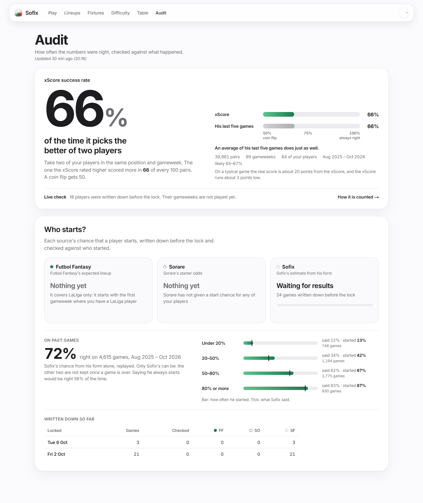

Audit has six views under the switch below the top bar (since 5 Oct): **xScore** (`/audit`, the charts below), **Who
starts** (`/audit/starts`, each source's record on who starts, with every gameweek's games written down before the lock
at its foot), **Lineups** (`/audit/lineups`, since 13 Oct: how often a lineup's real score landed within 15 points of the expected one, for
Sofix's and Sorare's plans as saved before the lock; then what your lineups, Sofix's and Sorare's won, each lineup counted once
by its best prize, a card, cash, essence, XP only or nothing, so XP is never counted as a win; the big figures are the best plan,
and every plan has its own row), **Strategies** (`/audit/strategies`, since 13 Oct), **Rewards** (`/audit/rewards`, since 6 Oct) and **Missions**
(`/audit/missions`, since 6 Oct).

**Strategies: podium and three charts (24 October).** The top podium ranks the best recorded strategies by average points, reward frequency, a named essence rarity or cash when known. Ties share a place; a large tied group expands to every name. All saved GWs is the default, and the ranking always uses the same competition/GW lineups for every recorded strategy.

The connected-dot chart shows each strategy against the best feasible lineup found by replaying your saved eligible cards and rules after results, including bonuses and captaincy. It shows matched coverage and the point gap; a missing replay stays unknown. This is the best saved replay found, not a guaranteed mathematical maximum. Your own entries, Sofix plan 1 and Sorare plan 1 retain their overall average points as unranked reference dots, with their own checked counts because coverage differs. They remain visible in owner-only weeks too. The scatter plot shows average points against rewards: upper right earns more of both. Overlapping strategies are grouped. The donut separates cards, cash, essence, XP only, nothing and pending prize checks; pending checks never count as losses and XP alone is not a reward.

Click a podium name, connected-dot row or scatter point, or choose **Inspect strategy**: all three charts highlight that strategy and show its picking rule. The donut also shows its average cash and essence amounts separately by currency/rarity. These are what the saved model picks would have earned against the saved actual cutoffs, not money received. **Gameweek results** and **Rank by** retain the selected filters, including rapid changes. Every known result shows from the first case.

**Lineups & cards** retains your entries, Sofix plan 1, Sorare plan 1 and every saved strategy with real card art and scores. The weekly numeric tables are removed. Older owner-only weeks remain available as card evidence even when there is no common strategy comparison. Saved source changes reopen completed weeks automatically; missing results stay pending and are retried after 14 days too. On **Lineups**, each week's comparison also keeps the saved score ranges, lucky/good/expected/poor verdicts and strategy matches.

The ten picking rules are best xScore, Sorare projection, keeper with his defender, three from one club, no attacker against the keeper, likely scorers, highest ceiling, usual score, surest starters and favourites only. Each is saved before lock and scored after results with its saved rules. No lineup is entered automatically. The replay command and definitions are in [backtesting](backtesting.md).

**Missions** uses the same selected-player verdicts as Limited/Rare history. A mission is hit when at least one selected player succeeds; a side waits only for its own selected players, with void games excluded. The headline and cumulative race compare shared checked missions. The taller race fills its section; its Reward switch compares all rewards, essence, XP, clues or a specific clue type on a shared cohort. This choice survives reopening. The action chart shows each side's independent hits / checked missions. Select an action or rarity to inspect its picks. Two compact bars count every known successful or failed pick: missed, essence, XP and clues. Hover, focus or tap a coloured segment for its pick and mission counts, total saved-term rewards and successful rarities only; Escape or an outside press closes it. Pending/void games remain separate. Reward equivalents retain unit and rarity. The pick evidence is paginated at twelve missions, followed by the existing history and corrections. Filters survive reopening and are applied on the server.

Selection outcomes update from the current mission log, so an incomplete eligible-card ceiling or an older published Audit cannot suppress a known picked-player result. The separate **Forecast coverage** disclosure retains the published best-available audit, its status filters and twelve records per page.

The best available result is capped at each mission's slots and judged independently: the same card may appear across missions, whereas Sofix's saved plan allocates each card once. Known empty allocations count as zero; missing forecasts do not. No-opportunity missions remain visible but leave the best-possible rate. Incomplete eligibility and reconstructed forecasts stay outside accuracy. Rewards are potential amounts calculated only from explicit saved per-choice/full-house terms, with XP, clue types and essence separate by rarity; they are not confirmed receipts.

Scheduled score checks, daily history and refreshes settle missions from the shared game store without an open browser. Missing results wait and later stat corrections revise outcomes. Old monthly days are checked unless that exact day and rarity was copied to a daily block. Historical forecasts or eligibility never saved cannot be recreated as verified accuracy.

**Rewards** answers "how much essence should I have won, and how much did I?". Play shows a reward as all or nothing; over a
season the fair yardstick is the expected essence: each lineup's chance of each reward times that reward, added up week by week.
**Sofix's plans** totals that expected essence (and cash, kept apart) over every finished gameweek the job kept, against what the
plans' lineups really won, and gives the share won ("80% of the essence they expected was won") once 100 lineups are behind it;
until then it says "Too few to tell yet" and how many lineups it has. The plan counted is the one Sofix rebuilds for a finished
week from what was known before its lock. **You** adds up what your own entered lineups won on Sorare, read week by week through the
extension (a signed-in sorare.com tab is needed for new reads; final weeks are saved on the server, with older browser readings
as a fallback), and sets it against the plans'
expected essence over the same weeks. **Week by week** lists each kept week: expected, won by the plan, won by you. Sofix's
plan weeks before 25 Sep 2026 (GW17) were not kept; your own saved season can include earlier weeks Sorare returns.

**Your lineups against the plan at lock** is a separate comparison with the exact plans saved before each lock. It shows
their expected score, their score from saved games, and your saved score in the same competition. It uses the saved
captain, card bonuses and substitution rules; a double week uses the player's best score. Missing results say **Pending results**;
older plans without scoring rules say **Rules not saved**. **No entry** and **Not saved** distinguish an empty competition from
a week Sofix has not archived. The heading shows how many entered lineups and GWs are saved. Live Sorare reads are labelled
**not archived in Sofix yet**; final reads are saved after the GW settles. Rewards need that week's final cut-offs.

On **Cards**, each card shows the season rewards of the saved lineups it was in. These are whole-lineup rewards, not
individual earnings: do not add them across cards. No saved entry and temporarily unavailable storage are labelled separately.

The Audit page checks Sofix's numbers against what happened. Its first view (**xScore**) leads with **Sofix against Sorare**
(since 13 Oct): each one's success rate in big. Both expected scores are saved before each lock for every player with a game. A number
that lands within 7 points of what the player scored is a success, anything else is a miss, and every player counts on his own. There
are two rates for each side: **starters** (the big one) and **substitutes** (players who came on), with the average points off under
each; the side that was right more often is marked. They show from the first game checked, with no 100-game floor, and a game counts as soon as its score is read (Sorare can still
correct a score for about a day). A substitute's game is judged against Sofix's score if he comes on, saved from the 13 Oct lock;
before that, against his start number. **Within 7 points, by position** draws both as bars,
overall and per position, and **The same games, three ways** lists the share within 7, the points off and which way each leans, for
starters, each position and substitutes, then week by week. The old **Sorare vs Sofix** tab is this view now (its address lands
here). The better-of-two figures are gone from the page.

Under it, **Past games, replayed** is a replay of two LaLiga seasons: every game predicted from the weeks before it only (9,190 starts
to 20 Sep).

- **How close** counts starts by how many points the score landed above or below the xScore; the four green bars in the middle are the starts within 7 points (31%); 63% are within 15.
- **Goalkeepers** and **Who starts** each plot what Sofix said against how often it happened: a dot on the dashed diagonal is honest.
- **Against Sorare's own number** sets the share of starts within 7 points of Sorare's projection (33%), of the old number (30%) and of the new one (31%), and the share of goalkeepers' starts inside the range (79%, the aim is 80).

These historical figures come from the local replay. **Who starts** now leads with the live accuracy of Futbol Fantasy,
Sorare and Sofix, each with its checked-game count, probability error and results for picks at 80% or more. The common
competition filter covers LaLiga, Premier League, Bundesliga, Ligue 1, Champions League, Europa League and Conference
League only. It changes the header, breakdown, probability charts, saved-GW record and predicted elevens together.
Missing coverage stays a dash; a checked zero stays 0%. Each source is measured on the games it actually forecast, so
counts can differ. The historical Sofix-only replay remains under **Historical Sofix replay**.

The live Audit checks every recorded player, including the LaLiga index and your players outside LaLiga, from saved games.
Who starts checks each game as soon as a usable start/non-start result is saved, including the predicted-eleven
comparisons. It does not wait for the GW to end or add 24 hours. A score still under review can provide a known start
fact; later corrections replace that case without counting it twice. Future games and unknown flags remain unchecked.
An explicit Sorare DNP is a non-start even if its start flag is missing. Source reads keep their existing schedule;
no extra Sorare requests are needed to count already-saved results. Full-GW score comparisons and Lineups keep their
existing finalisation requirements. Lineups keeps retrying missing results and paying scores beyond 14 days.

**Predicted vs actual** offers all three chart styles: **A · Connected dots**, **B · Calibration**, and **C · Paired bars**.
Choose FF, Sorare or Sofix. Dots connect the mean predicted chance to the observed starting rate; paired bars show those
same values. In Calibration, predictions run horizontally and actual starts vertically: the diagonal means agreement.
Select a point with touch or keyboard, or choose its chance range, to see the exact values and game count. Probability
ranges are paginated after 12 in A/C. Competition, source, chart style and pagination are kept in the URL.

There is no 100-case rule for Who starts or for automatic start-chance corrections (owner, 24 October). Every existing
five-point probability band uses its own observed starting rate from its first checked case; adjacent bands no longer
pool to reach 100. Forecasts shift by the band's observed rate minus its mean prediction, clamped to 0-100%. Raw
pre-lock predictions remain unchanged in the record. The charts describe the selected competition scope; automatic
forecast corrections continue to use all saved eligible evidence. Existing plans update on their next scheduled rebuild.

**Written down so far** is a compact gameweek timeline. Open a week to see how many predictions each source saved.
**Predicted elevens** compares FF's saved eleven with Sorare and Sofix's choices in the same formation. Switch between
All games, Gameweek and Club; lists beyond 12 groups are paginated. Rates show from the first checked starter, with
started/checked and picked counts. A missing result is never counted as a non-start.

**Match forecasts, checked**, below xScore, compares Sofix with bookmaker prices on the same finished LaLiga matches.
Forecasts update until kick-off and then stay fixed. Closing CSV prices come first, then the last available pre-match
price. Both sources appear side by side from the first compared match, as **forecast error points out of 100**: 0 is
perfect and 100 is the worst possible error. These points measure the error in the predicted win/draw/loss chances.
Lower is better; the lower source and gap in points are shown. This is the published Ranked Probability Score (RPS)
multiplied by 100, rounded to one decimal: 0.1082 becomes 10.8/100. It is not a percentage of correct predictions.
Compared matches and saved forecasts are counted separately; **How this is checked** opens the method, original RPS
values and saved odds date. Missing prices or results stay pending.
The odds record keeps its own copy of prices and says **Odds up to** the newest saved match date. A source stopping
only stops new readings; saved prices remain available.
Older seasons back to 2016/17 are read once if the runner's cache did not already hold them.

The Audit page never writes to Sorare. It is rebuilt by each refresh; "The audit appears after the next refresh" means none has
written it yet.

## 8. Apply a lineup

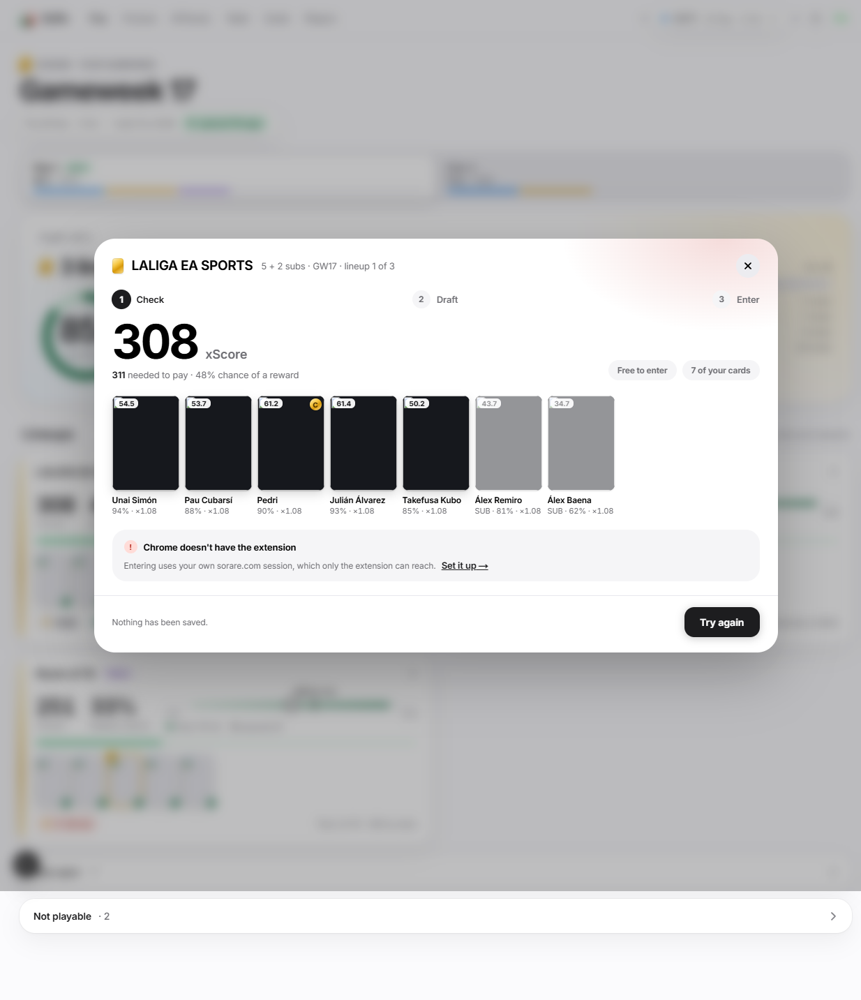

Apply is the only Sofix flow that can change Sorare. It requires the configured extension, a signed-in Sorare tab,
the matching Sorare account and an unlocked/non-stale plan.

1. **Open Apply.** Sofix reads already-entered lineups and available slots; this is read-only.
2. **Check.** Sorare previews the appearances and returns its rule verdict, bonuses, multiplier, costs and errors.
   Nothing is saved.
3. **Save draft.** Sorare creates or updates a draft. The lineup is not yet entered.
4. **Enter.** A separate explicit confirmation calls Sorare's confirm operation. This can consume a slot or fee.

Never treat Check or Draft as proof of entry. Read Sorare's returned feedback. If Sofix and Sorare disagree, stop:
the server's rule verdict wins and the mismatch is a bug to investigate. Sofix never schedules or auto-retries Enter.

## 9. Gallery (Cards)

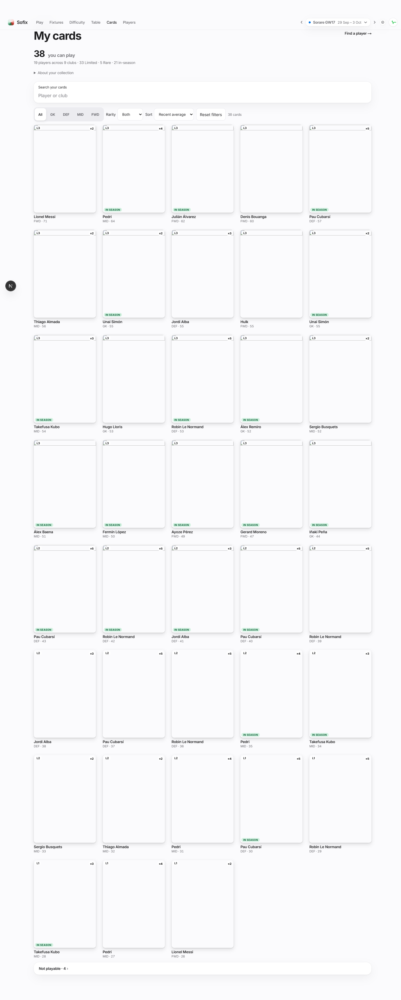

Cards is the latest synced collection snapshot, not a historical collection at the selected week. It distinguishes:

- usable cards from sealed/for-sale/in-offer/otherwise excluded cards;
- physical cards from distinct players, because duplicates do not create another usable player in one lineup;
- position and rarity balance;
- L5/L10/L40 form, play share and gameplay tier when supplied.

The three score hexagons are coloured where Sorare colours them, on the score as drawn: up to 20 red, 21 to 35 orange, 36 to 50
yellow, 51 to 60 lime, 61 to 75 green, 76 and above cyan. They are the same bands the sorare.com overlay uses, in softer tones.

Under each card is **his next game** (opponent, `v` home or `@` away, kickoff in Madrid time) and **his chance to start it** from each
source that has one: Futbol Fantasy (FF), Sorare (SO) and Sofix (SF). The darker number is the one Sofix uses. The game is the earliest one
still to come in any week the page holds, so a player called up by his national team shows that game; Futbol Fantasy only speaks about a
club's next LaLiga game. A card whose player has no game in the weeks Sorare has opened says "No game yet". A player of yours linked from
Lineups is outlined here.

Search by player or club, filter position/rarity and change sort; those choices are URL state and can be bookmarked.
Excluded cards are folded rather than deleted so the reason remains inspectable.

**Stats** (`/stats`, the Gallery's third view) ranks the current LaLiga players by their mean count of one Sorare action per start,
over every saved start of the last two seasons (the daily stat sheets). The page reads as a sentence, "Most Goals per start": press the
stat to open a palette of every action the sheets hold (type to narrow it), or step with the arrows. The second line carries on the
sentence: "among everyone / goalkeepers / defenders / midfielders / forwards with 3+ / 10+ / 20+ starts" (default everyone, 10+, so four
lucky games do not lead a list), then how many players that is and their average (a player who never did it counts as none). The first
five stand on a staircase, 1st on the left, each step as tall as his number against the leader's, with a dashed line across the steps at
the average; ranks 6 to 10 follow as big cards ("Close behind") and 11 to 50 as a wall, each card with its number on it. A player you own
shows your own card and a **Yours** mark. Each stat group has its colour; the choice stays in the address (`?stat=&min=&pos=`).

Below the leaders, four charts show who stands out among every player of LaLiga, the Premier League, Ligue 1, the Bundesliga and Serie A
with five starts, over **Season / L5 / L10 / L40** (this season's starts, or his last 5, 10 or 40). **Scatter**: any two stats (the axis
titles are the pickers), one league or all from one menu, one position; hover a dot for his card, his two numbers and his place, click to
keep it. **Clubs**: each club a bubble of its players, sized by what he does of the stat per start, with his share of the club's printed
in it; click a club to zoom. **Face-off**: up to three players of one position from any league (search to add) on a twelve-stat radar,
each against every player of that position. **Look-alikes**: pick any player and his twelve closest look-alikes gather round, closer when
more alike; click one to see his. A stat a position's sheet does not have (no "possession won" for forwards) leaves those players out
instead of putting them at 0. The league-history job builds them daily (read model `stat_charts`, backend `app/sorare/stat_charts.py`);
each player's name, club, league and real Sorare card come from Sorare's public API, asked again once a week. The tab and window stay in
the address (`?chart=&cw=`).

**Prices** (`/prices`, the Gallery's fourth view) says how far your gallery is up or down on what you paid ("Your gallery is up +€43.50"),
with what the bought cards cost and are worth now. A tide line stands every bought card on what it cost: a green bar for each gain,
a red one for each loss, best on the left, with the biggest gain and the biggest loss named on their card (hover a bar for its card).
Below, every bought card with its gain, "paid → now" and the change in percent, sorted by biggest gain, biggest loss or worth. Cards you
did not buy (crafted from essence, won) come last at their worth. What you paid is Sorare's record of your purchase; the worth is
Sorare's market value for that player at the card's rarity and season, not an offer for the card. A card Sorare does not value is left out and counted.

## 10a. Missions

**Load today's missions** reads Sorare's open football pickers through your signed-in sorare.com tab, using extension **0.3.9**. Press Reload on the extension once after updating it. Sofix reads the task group used by Sorare's Missions page, separately for each rarity, and saves one verified import. Missing fields, a partial response, a different signed-in account or a failed save are errors; they do not mean Sorare has no missions. The last saved list is kept and dated. Only a complete read can confirm an empty list. A phone can show saved data; importing needs the extension browser.

An older extension shows its version, Reload instructions and **Check extension and load**, which checks the running version again. Loaded missions remain visible even if the main player snapshot is unavailable. The heading always names the mission day, and the **fallback game window** displays both Madrid dates and times; it is an unverified reset convention, not a submission deadline. Imported task start timestamps are shown separately when Sorare supplies them.

Each open mission is a **ticket** (reward, rule, picks made, open slots, lock time); press one and everything beneath answers for that mission: **your imported Sorare picks beside Sofix's suggestions** as real cards with the chance and their last ten games as dots (big dot started, small dot came on, green he did it), including locked selections. Sofix keeps its full independent selection even when your slots are filled. Your imported picks never reserve cards away from its benchmark; Sofix's own allocation still reserves card copies across missions. Separate copies can serve different missions; a card in a normal Sorare lineup is not automatically excluded. Reward preference is **Essence first, clues second, XP third**. Sofix never enters your mission picks; make them on Sorare before the relevant kickoff.

The mission inventory is separate from the weekly lineup optimizer. Loading missions discovers each task's actual pickable games and pages through its eligible owned cards in bounded batches, including games absent from Sofix's weekly pool. National-team fixtures name the side actually playing. Suggestions and **Your cards** use the same mission-specific inventory. Eligible cards remain selectable without a forecast; an incomplete check is marked partial rather than shown as zero. An empty recommendation is not proof that you have no eligible cards. A mission restricted to a club or competition gets picks only once that check comes back (extension 0.3.20, 20 Oct 2026: Sorare had started refusing the older check, so those missions showed none). Sofix fills every open slot of a mission with an eligible card, even a long shot: cards with a chance go first, and one with no estimate is shown as "No estimate · fills an open slot" rather than 0%. Picks already saved for the day are kept; only open slots are filled later. A new kind of mission on one stat ("2+ clearances") is rated, shown and checked on its own: Sofix counts the stat Sorare names for it in each player's recent games, with no update needed; only a mission Sorare words without naming a stat stays unrated.

**Your cards**, below the picks, is one table row per card for the chosen mission: his card (FF's own start number in the Start column, even when Sofix works the chance out from it corrected by the record) with a dark person mark if you picked it and a small Sofix square if Sofix did, his opponent's crest (hover for the game and kickoff), chance to start and come on, his last ten games, how often he hit the target when he started and when he came on, three related per-game stats that change with the mission (goals, assists and clean sheets for a decisive action; tackles and ball wins for interceptions, and so on) and Sofix's chance (a player who has not come on lately but has at most a 10% chance of coming on is counted on his starts only, instead of showing a dash). Filter by All / Before kickoff / Yours / Shortlist and by position, search by name, sort by game, start, last 10 or chance (the header buttons), compare up to three players and keep a local shortlist. Shortlisting does not change Sofix's independent benchmark. The shortlist stays in this browser for that mission day and rarity; it does not enter anything on Sorare or sync to another device.

The arrow at the end of a row opens the card's **last 5 and 10 appearances before the mission day**, the **current season**, and that season's **starts / substitute appearances** separately. Season follows the current club’s domestic league, including calendar-year leagues and Japan’s 2026 transition. Each average shows its actual recorded sample; missing early-season games fill through the daily history read. DNPs and appearances with missing stats are counted separately; a missing reading is never a zero. **All recorded stats** expands every supplied Sorare action, including accurate passes and shots on target. Clicking card art opens the player's Sofix profile.

**Best cards** chooses independently for each mission, so a card can repeat between missions. **Each card once** uses each card copy once across the day, preferring Essence, then clues, then XP. Your Sorare picks and local shortlist never reduce either view. History has its own view selector and compares each saved reference separately against your results on the same settled missions. Success means matching the best possible result from the owned candidates; days with no achiever, pending/void results and missing forecasts are excluded.

Decisive and count estimates use the most recent ten appearances split by playing role, falling back to that season's role average when the recent window has none. They weight starter/substitute rates by that game's playing chances; count targets use a Poisson approximation. If a needed role's data is missing, no probability is invented. Score targets and unknown availability show **recent target hits** with at least five known readings. These are heuristic estimates, not calibrated probabilities.

The table opens on **All**, including locked and already selected cards for comparison. **Before kickoff** filters to editable copies. Locked cards use their captured form; an older record without it says so. Unsupported targets retain their original rule and eligible inventory.

Count targets include goals, assists, interceptions, **shots on target**, **tackles won**, **accurate passes** and, since 13 Oct 2026, **big chances missed**. A **Discipline** mission (a yellow or a red card, 14 Oct 2026) is rated like a decisive one: the share of his recent games in which he was booked. The imported threshold drives both estimation and settlement. Saved picks and form freeze at kickoff. Historical records without a best-cards reference or dated form remain explicitly unrecorded; new form never fills a missing past forecast.

"Today" follows the existing **9:00 CET / 08:00 UTC** reset convention, including matches after midnight before that reset. Historical imports use the source task's start-date calendar day in Madrid, rather than the date you fetched them. The live summer reset boundary still needs comparison with a signed-in Sorare response; Sofix does not silently reinterpret old dates.

**History** uses one row per date, closed by default and showing the date and its number of missions; click the date to open that day's missions with your picks, Sofix's picks, results and editing. Choosing a date in **Mission date** opens it straight away. Above the days, **All time** sets you against Sofix over every kept mission day as hits in missions, e.g. **5/10**: each mission of each day counts once and is a hit when at least one pick did what it asked. A side counts only the missions it picked for, so a mission where Sofix had no pick still counts for you; a mission waits until all its picks' games are checked. It lists every date from the first tracked day within the last 30 days, even with no recommendations. An unloaded date assumes only one **Decisive Picker** and is labelled as assumed. Imported picks remain visible without a captured forecast; missing evidence is excluded from accuracy figures. Supported entries show Sofix's score against the best possible and the achievers it missed. Sorare's imported SUCCESS/FAILURE verdict on your selection takes precedence over calculated stats. Your supported target can settle from saved stats even without a Sofix forecast. **You versus Sofix** uses the same fully settled missions for both sides: success means matching the best possible result. Missing forecasts, pending/void picks and unconfirmed empty imports do not enter that comparison.

**Edit my picks** corrects your Sofix history. Add or remove cards from the captured candidates, original imported selections (including sold cards) or current collection; a manually named player remains an unverified user report. Respect the mission's slot limit, add a note, preview, then save. **I made no picks** stores an explicit empty correction. **Restore imported picks** removes your override. Corrections stay separate from the original Sorare import and Sofix's frozen forecast, survive later imports and refreshes, and reject an outdated edit from another session. The Missions Audit shows the correction too.

The editor shows card images, years and copy numbers where recorded. Your picks and the searchable card list sit side by side on desktop and stack on phones, using Sofix's shared white surfaces and compact actions. Search by player name or paste a Sorare card/player link for a missing card; the technical player reference is an advanced fallback. Unsaved edits require **Keep editing** or **Discard changes** before closing, switching dates, following a page link or reconciling history. History distinguishes source-confirmed no picks, your explicit no-picks correction and unknown imports. A missing forecast says **Forecast not recorded**; **Results pending** is reserved for a captured forecast awaiting results.

**Reconcile Sorare history** reads archived pickers from the same task group through the extension, bounded to the last 61 days and 200 dated tasks per rarity. It restores available source selections and verdicts without recreating old forecasts. Undated or unavailable tasks remain unknown and can be corrected manually. The public schema accepts these reads; final parity with your signed-in Sorare account requires reloading the extension and trying an import.

## 10b. Arcade — Sorare's free common-card board

**Arcade** in the top bar (and the phone's bottom bar) climbs Sorare's free board with your current set's commons. Everything is
read in your browser from your signed-in Sorare tab (extension 0.4.15 or later; no page opens); nothing is entered or cancelled on Sorare.

- **Your climb · Pick a day**: the big number is your chance to clear the highest step within reach before the set ends, with its
  prize and your lives. **The tower** gives every step's chance, the days the plan plays it and the cards of its lineup (every step,
  not only yours); **Departures** lists the chosen days' lineups in the order they settle (time, step, games, chance); **On deck** shows
  one with its five cards. A lineup may take games from up to 3 days in a row, so a thin day (Thursday's European games, Friday's few
  league games) joins the next instead of being skipped. The strip says, for every day or span left, how many lineups to play on which
  step, or **Hold** to keep lives for a better day (losing a step's last life sends you back to step 1; rewards won stay won). It plans
  past a step whose lives are all waiting, and past a cleared step you have not claimed. The strip draws the likely path; under a played
  day, **If one clears** and **If all miss** open the other outcome (the next step's days and lineups, or the retry with the lives left,
  or step 1 after the last one), and **Back to the likely plan** returns. A **Hold** day still shows its best lineup and chance, not played.
- **Pick teams**: games as tickets with Sofix's difficulty for both clubs; **Easiest games** picks those where one of your clubs is
  favourite on Sofix's board. The best five stand on a pitch, and **Where it lands** gives the chance at every step.
- **Your lineups on Sorare**: each lineup you entered, as a race to the target: points so far, what its cards still to play add at
  their best, **Dead** when that cannot reach the target, and **Cut losses** when cancelling it (a life, as a miss) helps the next lineup more.
- A card's number = Sofix's xScore for a LaLiga, Premier League, Bundesliga or Ligue 1 game (else Sorare's projection, else his average when he
  plays) × his start % (Sofix's in those three leagues) × Sorare's bonuses (edition + club + captain),
  with the range he scored in 6 of his last 10 games he played. "No start % yet" cards count as starting. A LaLiga, Premier League, Bundesliga or
  Ligue 1 game shows **Sofix's difficulty** for the card's club (1 easiest), with the clean-sheet chance for keepers and defenders
  and expected goals for the others. It is shown, not added to the card's number.
- **Start %** come from your open Sorare tab for every day to the set's end, kept 6 hours (the **Refresh start percentages** icon) and saved, so the
  newest saved reading shows on any visit. Your cards are kept in this browser and read again only when Sorare's count changes (a pack
  opened). The page opens on your last read board, dated, while Sorare is asked what changed; if Sorare cannot be read, it stays and says why.
- **Your cards** shows 12 larger cards per page. FDR (0–100, lower is easier) and xScore sit at the upper right; the edition bonus sits at the lower right. Below: start %, fixture crests and xD (expected decisives). Click a fixture's crests to show its ratings. Search, league, position, edition, start % and FDR filters combine; filters and sorting refer to the next fixture and start a new first page. Unknown stays a dash; zero stays zero. xD is the fixture’s expected decisive contribution, including starter and substitute chances; it is a decimal, separate from conditional mission odds. It stays unknown until a fixture forecast is published.
- The icon toolbar beneath your wallet refreshes the **board and cards**, **start percentages** and **scores**. Hover or focus identifies each action; the information icon opens start-percentage coverage and read details. A failed read keeps the last successful data and explains the failure. Older extensions retain the named start-read fallback that opens Sorare's page.
- **Packs**: **Work out the best pack** reads Sorare's odds and opens on the pack you can afford that gives the most players you do not have yet. **Bronze / Silver / Gold / Special** filter the list and pick. **Today's missions** keeps your selection beside five alternatives, ranked by the shared L5/L10/L20/L40 history window. Decisive odds use the conditional fixture model where available, otherwise starter history; start % is shown separately and never discounts those odds. Saved pre-game forecasts remain frozen.

## 10. Players

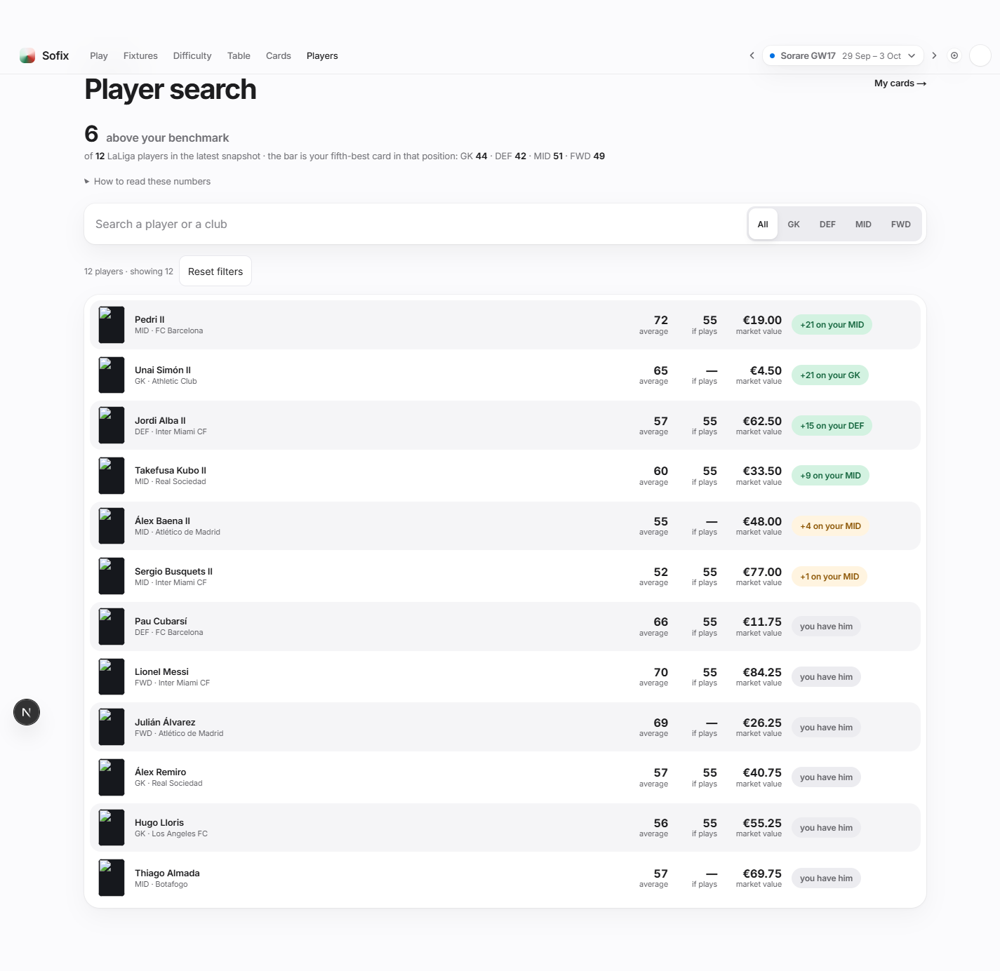

Use **Competition** on Players to choose LaLiga, Premier League, Bundesliga or Ligue 1; the calendar week stays selected. The top-bar search finds players across all four leagues, and a player bookmark opens directly without visiting the league first. All 20 Premier League, 18 Bundesliga and 18 Ligue 1 squads are collected automatically during refresh, including players you do not own. Their recent history is collected by match and reused between runs. A failed squad read retains identities and expires its forecasts; a forecast older than 24 hours is hidden unless the exact selected GW has a saved record.

Premier League and Bundesliga use separate Sofix models, validated on the complete 2025/26 held-out starter cohorts against recent form and a no-FDR ablation. This validates scores conditional on starting retrospectively; start chances and future blind accuracy remain separate. The [validation report](pl-bundesliga-xscore-validation.md) records the gates and the single missing PL training replay. A missing FDR context, cup or national-team game uses the displayed Form/Sorare source, never LaLiga's learned model or invented match odds. The fixture names the actual playing side. Missing averages and forecasts show a dash; genuine zero remains zero.

Players is a cached index of **every LaLiga player** (priced or not), built from LaLiga club squads during refresh—one competition
query plus one query per club. Search is local and fast; it does not make a Sorare request per keystroke.

**In LaLiga, every player gets this week's numbers, not only yours** (since 6 Oct 2026). For the gameweek being planned each row shows his
**chance to start** (with whose number it is: FF, SO or SF, as on your cards; "Plays" when only a chance of playing is known) and his
**xScore**, worked out the same way as for your cards: Futbol Fantasy's expected lineup, Sorare's odds and projection, his game and
its odds. Past-game form counts for everyone: your players are read every refresh, and every LaLiga player plus your players
elsewhere are read once a day by their own job (**League history** in GitHub's Actions, about 05:30 Madrid; it can also be started by
hand there), so each player has his latest game by the morning refresh. Control shows its last run under "Last refreshes"
("Every player's past games: 618 of 618 read …"), with **Read now** to start it whenever you want. A run that is cut off keeps what it read and the next one carries on. Until a
player's games have been read, his numbers rest on those sources and the usual priors. A dash
means no forecast is saved for the selected GW. Players and individual player links preserve that GW, including its frozen
forecasts after the optimizer moves on. Games already read stay saved when a source fails or a player leaves your collection.
Later reads add new games and corrections. Without a source's start chance, a red card or fifth LaLiga yellow rules him out
of his next LaLiga game; a second game in that week is still available.
The refresh also saves each source's start chance and score before the week locks, including FF's predicted starters.
Those readings freeze at lock; a missing source leaves its last saved reading in place.

**One player's page** (since 4 Oct, `/players/<name>`; click a name in the results). It leads with his selected GW's game: the xScore if he starts (or if he plays when no starting score was saved) and the chance he
starts, large (for any LaLiga player), and the picture of the game (the same bars as the panel on Sorare, and "Lands between 41 and 80, 8 times in 10"). Below, the **stat sheet** is one table with a
picker, **Next game** (when his game is priced), **Last 10** or **Saved starts**: what he does in a start (saves, passes, tackles, chances created...) with the points Sorare gives for each,
and the total. "Next game" is his saved-start average moved by the game: more saves against a stronger attack, more chances against a weaker defence (never more than 60% off an average
game). Beside it, **how he compares** with the others of his position with eight starts or more (one dot each, where he and the middle one are, and "higher than 69%"), and **his last ten
starts** as bars (green where he had a decisive action), with his clean sheets and penalties saved for a goalkeeper. A player of yours also gets **his next games** (up to five: the xScore
and the range he lands in). The daily history job builds the stat sheet from permanently saved games and says "to <date>";
it needs at least three final starts with complete stats and a known playing side, position and decisive level. An unread stat sheet is not a zero-action game.

The approved local export import added 2025/26 and early 2026/27 to **Saved starts** on 9 Oct. It preserves
the daily job's readings and includes both seasons in the sheet; **This season** still shows only the current season.
Old export projections do not become saved forecasts. Games absent from the export still wait for a source reading.

**This season** lists every saved game, newest first, with its real home and away sides, competition, appearance, minutes,
score and cards. Sofix and Sorare forecasts appear beside the result where they were saved before lock. The summary counts
games played and starts, averages known appearance scores, and checks each forecast's mean miss on known starts only. **FF start calls** counts how often Futbol Fantasy called his start right
(50% or more and he started, under 50% and he did not), and each game shows what FF said.
LaLiga yellows are separate from other competitions; four in a cycle says "one away from a ban" only when every saved
LaLiga game's cards were read. Otherwise the count says "at least". Unread results, minutes, cards and forecasts say so;
the latest saved game and last reading stay visible when a source stops.

**Injuries and suspensions** keeps Futbol Fantasy's reported spells, with the first and last reading, its reason and a link
when the player is linked. A spell closes only when a fresh page reports him available; an empty or failed page cannot
mark him recovered. "Returned by" is when Sofix read his return, rather than a medical date. No saved spell does not mean
he has never been injured. This history does not change the start chance.

Each result shows his chance to start, his xScore, recent average, Sorare projection **if he plays**, cached Limited market value
(a dash when Sorare quotes none), and the improvement
against the fifth-best owned card in the same position. Only a player at least **70% to start** (his chance to play when
no start chance is known) counts as an upgrade; a better one less likely to start shows his gain in grey with "starts 40%". “You have him” prevents an owned player being presented as
a new signing. The price is Sorare's last-synced market valuation, not the lowest current listing and not an offer
Sofix can execute.

A dash under **Projected** means Sorare has not given a projection for his next game: Sorare scores a game ahead only once it has
opened its week. The line above the results says when it is due (Madrid time), or that Sorare gives none; the dash itself carries the same
words on hover.

If the index is empty, the page should show a sync/schema/key state. It must not broaden silently to other leagues.

## 11. Control Center

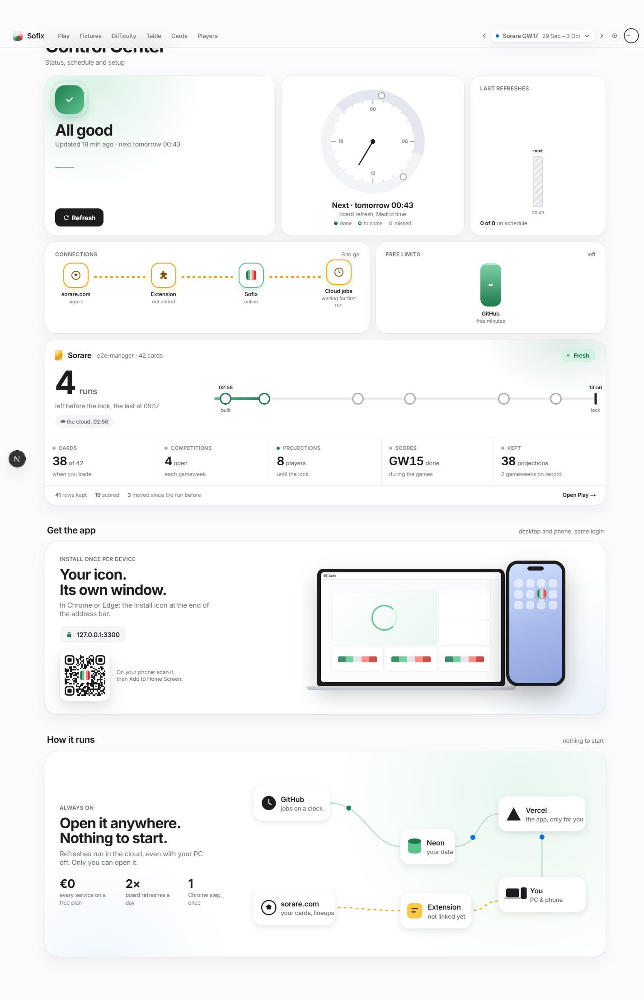

Control is the operational truth for the owner:

- **All good / failure state** and last-update age;
- manual **Refresh**, which dispatches the same GitHub workflow as the schedule;
- next scheduled runs and recent run history;
- **Saved data**, below Last refreshes: player games and players, odds and their source, match forecasts, absence spells,
  and your saved weeks, each with coverage and its last read/save date;
- connection chain: Sorare sign-in → extension → Sofix → cloud jobs;
- remaining Odds API credits and Neon storage where available;
- Sorare sync freshness and forecast/replay counts;
- PWA installation and QR;
- extension and GitHub setup instructions when a piece is missing;
- a diagram of the always-on cloud path.

The scheduled times are 07:17, 12:07 and 22:43 UTC daily, plus the two-hours-before-the-lock runs on Monday to Thursday (13:37 and
15:07 UTC; Tuesday only 15:07), Tuesday 13:23 and Friday 17:23 UTC: three a day at the least and five on a Europe day, which is
the "3–5×" the page shows (read from the schedule itself, `lib/schedule.ts`). The UI converts them to
Madrid time, so the local hour moves at daylight-saving changes. Manual refresh has a ten-minute cooldown and cannot
run alongside another refresh. It does not apply migrations.

Saved data is a dated check, not a live monitor. Game rows include pending fixtures; **Latest past game** excludes future
dates. An absence without a recorded return does not claim the player is still out. Source failures and partial daily
reads show a warning while keeping the stored coverage. Odds prices can name a future match. Your weeks count only
weeks already archived from Chrome; a new save appears in coverage after the next refresh or daily games run.

If GitHub/extension setup is missing, Control gives the required owner step. Never paste a token into chat, an issue
or a committed file.

## 12. Chrome extension

### Install or rebuild

The extension is a local Manifest V3 build, not a store listing.

**0.3.10 repairs the production 0.3.9 bridge:** the production address is explicitly allowed, interactive lineup reads
take priority over season archiving, and task eligibility includes cards missing from the weekly pool. After the folder
is rebuilt, press **Reload** on Sofix in `chrome://extensions`, reload your Sorare tab, then reload Sofix.

1. In root `.env`, set `APP_URL`, a random `EXTENSION_TOKEN` of at least 32 bytes, and
   `VERCEL_BYPASS_SECRET`.
2. Run `node extension/scripts/configure.mjs` from the repository root.
3. Open `chrome://extensions`, enable **Developer mode**, choose **Load unpacked**, and select `extension/`. If Sofix
   was already loaded, press its circular-arrow **Reload** button instead; a changed file on disk does not update the
   running Chrome extension by itself. Reload the already-open `sorare.com` tab too, because its page bridge was
   injected by the previous extension build.
4. In that same Chrome profile, open Sofix and a signed-in `sorare.com` tab, then check Control. The popup can
   disable/enable the overlay. Codex's in-app browser and other browsers cannot call a Chrome extension.

`manifest.json` and `config.js` are generated and git-ignored because the latter holds secrets. Re-run configure and
reload the extension after changing the app origin or token.

**A new version.** Reload only picks up what is on disk in the folder Chrome loaded. When Control says "update" next to the
extension, first bring that checkout up to `main` (`git switch main`, `git pull`; set aside uncommitted work first with
`git stash push -u`), then run `node extension/scripts/configure.mjs` again, because `manifest.json` is rebuilt from the template,
and only then press **Reload** and reload the `sorare.com` tab.

### Cards on sorare.com

On Sorare's football pages Sofix draws a small dark-glass **tile** inside the top-left corner of each card it can name: your
cards, and since 22 Oct any LaLiga, Premier League, Bundesliga or Ligue 1 player Sofix rates (Arcade commons included), with Sofix's xScore,
chance to play and that league's difficulty for the week being planned.
The big number is the score he is expected to score **if he starts** (a small shirt marks it), painted in Sorare's own
colour for that score. Under it is one thing that drives the score, chosen by position:

- **Goalkeepers and defenders: FDR**, Sofix's difficulty of his game (0 to 100), in Sorare's five colours from cyan
  (very favourite) to red (big underdog). It is the same number as the difficulty page.
**A goalkeeper's number follows his game.** It is no longer his last five games: those are mostly luck (a clean sheet is worth about 75, a game without
one about 40), so Sofix works out how likely his side is to keep a clean sheet (its own numbers, adjusted by the bookmakers' goals line), what he scores if it does
and if it does not. Since 26 Oct 2026 it no longer uses Sorare's projection: Sofix's number stands on its own data, with Sorare's beside it to compare. Two keepers' numbers sit closer together than before and move with the opponent. In a test on
738 starts, the new number put the better of two keepers first 54 times in 100 (the old one 50, a coin flip); it lands within 7 points about a quarter of the time,
like every other number, since a keeper's game swings that much. A game Sofix has no numbers for (a cup game, a game too far ahead) keeps the old number.

**Every outfield number follows the game too.** A defender's, midfielder's or forward's "if he starts" is no longer only his last five games: it also
counts how likely his side is to keep a clean sheet and to score (Sofix's own numbers and the bookmakers' goals line), home or away, and his own record of big
scores (not Sorare's projection, since 26 Oct 2026). In a test on every start of two seasons it was closer to what players scored than the old number for all three positions,
and put the better of two players first about 59 times in 100 against 54 to 57 before. It still lands within 7 points only about a third of the time: a game is a goal
or not. A game Sofix has no numbers for keeps the old number.

**Lineups count players of one game together.** A keeper and his defenders tend to score well or badly together, and a keeper against the other side's forwards the other way round, so a lineup that stacks them swings more than the plan used to say. The chances and ranges on the plans now include that, and the captain is the player who gives the lineup the best chance of a reward, which is not always the one with the highest average.
- **Midfielders and forwards: xG**, his expected goals if he starts: his season's rate from Understat, scaled to how many
  goals his side is expected to score in that game. It is there for players Understat can name in the Premier League, La
  Liga, Bundesliga, Serie A, Ligue 1 and the Russian league who have played at least a full game. Anyone else, and any
  player at a club in another league, shows **No xG** where the xG would be, rather than a made-up number. (A goalkeeper
  or defender whose game is not priced shows **No odds**, since his line is the game's difficulty.)

On the compose page, directly under Sorare's own win / draw / loss bar, Sofix adds a row: **its win % and its clean
sheet %** for that game. For a LaLiga game they are Sofix's own model; for any other league or a national team they come
from Sorare's odds for the game. Sorare fills those odds only in the last few days before a game, so a card whose game is
not priced shows the tile and no row. Sorare's bar is found by what it says (three percentages) and where it is, up to
about half a card's height under the picture: on a list of cards it is the third row of the block under each card. To make
room, Sofix moves Sorare's next line ("Best score chosen", the kickoff) down a few pixels; if that line cannot be moved, the
row is not drawn.

**Hover the tile, or focus it with the keyboard**, and a panel opens beside the card (since version 0.3.3, 4 Oct, it is wider and shows the game, not only the number: "the picture of his game" below; press Reload on the extension in chrome://extensions to get it, and the app's Control Center says "update" until you do). From the top: SOFIX with a small green chip
when your best plan uses the card (the lineup's name, and a C for the captain) and how long ago the numbers were made; a switch
between the score if he **starts** (the default) and if he **comes on** from the bench; the big score with his chance of starting and whose
number it is ("START · FF"; on the other side, "COMES ON 30%": how often he still plays when he is not in the eleven). The "comes on" score is a real score:
a substitute starts at 35 points like a starter, so it is near 40 whatever his chance (until 3 Oct the panel showed that chance multiplied into it, which
read 1 for a goalkeeper; a payload from before the change still says "benched" and shows the old number); **the picture of his game** (below the big number: forty bars of how likely each score is, the white one where his number sits, the green ones the range he lands in 8 times in 10, the lighter green the games where he gets a goal, an assist or a clean sheet, labelled with where those games land and how often ("75 · 6%"), and the two ends of the range under it) and **what moves it in points**, at most two lines about this game ("Barcelona −8" for the opponent, "Attack +5", "Form +7", "Minutes −9" when he comes on); one line only when FF says something is wrong with him ("Doubt · since 12 Sep", amber, or an
injury or ban, red); three numbers (xG or clean sheet for his job, his side's win chance, and the difficulty); and **SOURCES**,
folded away, which opens to what FF, SO and SF each say and when FF was read; for a national-team game or another league's, where FF
has no number, its row says "LaLiga only" (FF covers LaLiga only). The overlay never shows FF's Spanish words; the Lineups page
translates them. Escape closes it. It only shows things; nothing in
it writes to Sorare.

- **His chance of starting** is the bottom row of every full tile ("90%") with a mark for whose it is: FF's expected lineup where
  it has him, else Sorare's odds, else the app's own. It is quiet while he probably starts, **amber in doubt** (FF calls him a
  doubt, or he is under 50%) and **red when he will not start** (injured, banned, or under 15%). A tile greyed as "Started" or
  "Old" has none, and a small lineup tile has no room for it. Hovering the row says it is Sofix's number and whose it stands on.
  **A mint ring** round the tile means Sofix and Sorare disagree on whether he starts: one says 40% or less, the other 60% or more
  (Sorare's own % is the badge at the card's foot on your Lineups page).
- **Your gallery's prices.** On your own gallery (with Sorare's "Show details" on), each card gets a line under Sorare's "Bought 2 days
  ago": what it is worth now and how far that is up or down on what you paid ("now €3.40 ▲13%", or "not bought" for a crafted or won
  card). The toolbar row adds the bought cards' total ("BOUGHT, NOW €312 · paid €268 for 30 cards · ▲ €44 · +16%"), the same figures as
  Prices. Values are Sorare's at Sofix's last refresh (the hover says when). Someone else's gallery gets nothing.
- **A player's page.** On a LaLiga player's Sorare page (any of its tabs), a strip above his name: his score if he starts, his chance
  to start with each source (FF, SO, SF), his club's next five games in the board's colours, and "Yours · in Arena" or what he would
  add to your squad ("Upgrade +6 on your MID"). The numbers are his Players page's. A player outside LaLiga gets nothing.
- **Live FF reads.** While a sorare.com page is open with the overlay on, the extension reads the Futbol Fantasy match pages of
  the games its cards are about, at most once every ten minutes each, and redraws the tile and panel when a chance changed (the
  panel then says "FF live 2 min ago"). The plan's ticks, xScore and #1 to #3 ranks stay as the last run made them. Version 0.3.0
  needs the extension reloaded with its manifest rebuilt (`node extension/scripts/configure.mjs`, then reload it in
  `chrome://extensions`) because it asks for one more site, `futbolfantasy.com/partidos`.
- **Two games in the gameweek** (an international week, a double gameweek): a small **×2** hangs off the tile's lower corner, the tile's
  name says "2 games this week, best score chosen" (Sorare's own words for which one counts), and the panel lists both, soonest first,
  the next one in white ("Sat 12:47 · v Slovenia", "Tue 12:47 · at Macedonia": the day and time in your browser's clock, "v" for a game at
  home, "at" for one away). The tile's numbers are still about the next game. A player with one game has neither. It needs version
  0.3.1: Reload on Sofix in `chrome://extensions` (Control says "update" until you do).
- **Loading** shows a shimmer; a **small card** (a lineup slot) gets the number alone, a **thumbnail** an even smaller one,
  and a picture under 48 px wide gets nothing.
- **Signed out or app unreachable:** a very small **SIGN IN** or **OFFLINE** tag, the only thing here that takes a click
  apart from the tile; it opens Sofix.

**Decisions.** Sofix's best plan for the gameweek marks the cards it would use: a white **tick** on the tile's corner for a
card in the plan and a gold **star** for its captain. Only the copy the plan uses is marked (your other copy of the same player
stays plain), and a card the plan leaves out shows nothing, never a warning. Which lineup it is in is on the panel's green chip. On a **"Select your ..." list of four or more cards**, the three with the best expected score
get **#1, #2, #3**, worked out from the cards on screen, so on a long list they can change as you scroll; there is no rank on a
page without that heading. When his game has started, or the numbers are more than a day old, the tile loses its colour and its
last line says **Started** or **Old**, instead of showing a confident number that no longer holds.

The tile takes about 5% of a card and none of its face. It starts below any chip of Sorare's own on that corner, never
touches the ones on the right (their percentage, the captain button, the lock timer, "Best value"), and a press on the
card anywhere except the tile still selects the card. Tiles appear for the players you own who have a game in the
gameweek; a card Sofix has nothing on gets nothing. Cards are found by the address of their picture, not by Sorare's
generated CSS class names.

**Fixed in 0.3.2 (found 3 Oct 2026).** The live Futbol Fantasy read found no player (it looked for a label in small letters that the site
writes with capitals), so the panel never said "FF live" and kept the last refresh's time; the Sofix tab showed the gameweek being planned
even on a page about another week; and every Celta game showed **No odds**, because Sorare's "Celta de Vigo" did not match the board's
"Celta". Reload Sofix in `chrome://extensions` (Control says "update" until you do); the Celta fix is in the app and needs no reload.

### The dock (extension 0.4.0, 20 Oct 2026; 0.4.1 adds the three things below)

- **Alarm (0.4.1):** the pill turns red with a count when a starter of the plan, whose game is still ahead, is under 50% to start (or
  injured or suspended). The lineup's row says "N at risk" and, opened, shows who would take his place: a player of yours at least 70%
  to start, chosen only among those the job lists as able to take that slot in that competition (its leagues, rarity, in-season
  cards, cap, a Pro lineup's hour; in no lineup of the plan; 0.4.4). A plan made before that list says so instead of guessing, and a
  Pro lineup points to Load from Sorare. **Swap** guides it on Sorare's lineup page. It watches Sofix's plan, not
  lineups you built by hand, and goes quiet at the lock.
- **Live score (0.4.1):** after the lock the pill shows the points your entered lineups have so far; each row says "191 of 260 · so far"
  and "70 to go" or "Reached". Read from Sorare through your tab, at most every two minutes while the panel is open.
- **Lineup page (0.4.1):** on Sorare's page where you pick the cards, the pill adds up Sofix's score for the cards in the slots and, once
  all are in, says "+6 vs plan" or "−4 vs plan" against the plan's lineup in that competition. Cards only: that page has no captain.

A small pill in the bottom-right corner of Sorare's football pages says the gameweek and when it locks ("GW24 · Locks 16:00"; in
the last hour "Locks in 42 min", in yellow), and carries a yellow badge when Sofix would swap a mission pick. Pressed, it opens a
400 px panel above it with two tabs; nothing else on Sorare's page is covered or dimmed. The week is the one the page's address names
(the one being planned when it names none; a week Sofix holds nothing on says so). **Pro tonight (0.4.3):** while the gameweek being
played has Pro lineups none of whose players has kicked off, the dock shows those instead (on a page naming no week or that week),
the soonest first, the pill saying when the first kicks off ("GW24 · Locks 21:00"), with **Load from Sorare** to rebuild them on the
announced elevens and Guide me to enter one. Enter never covers Pro: it is entered on Sorare's Pro board.

- **Lineups**: the chance of any reward and the essence expected, then one row per lineup of the best plan, likeliest to pay first
  (three of its cards, its expected score against the score that pays, the days it plays, its chance). A row opens to every card with
  the score it is expected to make and the captain, and two buttons:
  - **Enter** runs Apply from Sorare itself, one press per step: **Check** (Sorare's verdict; it first reads whether that lineup is
    already entered and stops if it is), **Save as a draft**, **Enter it now**. **Enter all N** at the bottom does the same for every
    lineup, still one press per step. A lineup Sorare refuses stops there with Sorare's words; a step whose answer cannot be verified
    says to check Sorare before pressing again.
  - **Guide me** is for entering by hand: the pill becomes the guide ("Pick Olasagasti · MID", 4 of 5, Skip) and the card to pick is
    ringed in green on Sorare's own list; pressing it moves to the next one. Nothing is picked for you.
  - The ⋯ button holds the rest: the cards used, and plans 2 and 3 (they open in Sofix).
- **Missions**: today's missions as Sofix's Missions page has them (loaded on their own when Sorare's missions page opens): each
  mission's reward, how many you picked and "As Sofix" or the swap Sofix would make, with both chances (your Akhomach 29% → its
  Mittelstädt 39%). **Swap** takes you to Sorare's missions page and guides it: the card to take out is ringed in yellow, then the one to
  pick in green. Sofix does not save mission picks itself (it knows no Sorare call for that yet).

The switch "Scores on sorare.com" turns the dock off with the tiles. It is hidden on narrow windows.

### Which gameweek a page is about

When the address of a Sorare page names a gameweek (Sorare names them by their dates, "football-25-29-sep-2026"), the tiles
are that gameweek's numbers and not this week's. A gameweek Sofix kept shows its numbers as they stood when it ended (grey,
"Started"); one it did not keep shows **no tiles at all** rather than this week's numbers under its name. A page whose
address names no gameweek shows the gameweek being planned, as before. The popup's **Gameweek in the address** row says
what the last page named ("25 29 sep 2026", or "none named"), which is how to tell whether a page carries one. The tiles follow
the page when Sorare moves to another gameweek without reloading, and back.

### The switch

The popup's **Scores on sorare.com** switch turns the tiles, the odds row and the tab on and off at once, with no
reload; switching off gives back the room made under Sorare's odds bar. (The old **Show chance of playing** switch is
gone: his chance of starting is now on every tile and in the panel.)
**Cards recognised here** shows how many cards on the page you are looking at Sofix could name ("7 of 7"). "0 of 8"
means Sorare has changed how it draws cards and the overlay needs an update. The larger "Sofix panel" on a player
page in the design preview (`S7-player-page.html`) is not built.

### Privacy and account matching

The extension captures the last Sorare GraphQL endpoint/headers in page memory only so allowlisted operations can
use the existing signed-in session. One read-only operation fetches all of the owner's lineups for the selected
Sorare fixture; Apply's separate competition-level read still checks capacity before a write. The extension never
sends the cookie/password to Sofix and exposes no general proxy. Check-in
sends only public username, version and Sorare build/revision. Which cards a page shows is sent only to your own Sofix
app, as card and player slugs, and only with the extension's secret token; answers are kept in the browser's memory
for 15 minutes. Matching the signed-in Sorare account to the Sofix owner is not enforced yet: the numbers go only to
the extension that holds the token.

## 13. Reading freshness and errors

| Message/state | Meaning | Action |
|---|---|---|
| Fresh / up to date | Latest publish is within its expected window | None |
| Waiting for projections | Sorare has not published the strong pre-lock inputs | Use form-only plan cautiously or wait |
| No odds yet | Optional odds step skipped/too old/no match | Use model lenses; do not interpret Odds as zero |
| This browser can't reach the extension | Sofix is open outside the Chrome profile that loaded it | Open Sofix in that Chrome profile; keep Sorare signed in there |
| Reload the Sofix extension | Chrome is running an older local build (lineup reads require v0.1.1+) | In `chrome://extensions`, press **Reload** on Sofix; reload the Sorare tab, then the app |
| Sorare tab missing / signed out | Actual lineups and Apply bridge are unavailable | Open Sorare in the same Chrome profile, sign in, then retry |
| Apply says "sorare.com isn't open" | Apply works through your signed-in Sorare tab | Open sorare.com in the same Chrome profile, then press the step again |
| Apply says "The tab needs a reload" | The sorare.com tab was opened before the extension was loaded, or Sorare's page has not made a call of its own yet | Reload the sorare.com tab, then press the step again |
| Apply says "You're signed out of Sorare" | Your Sorare session ended | Sign in on sorare.com, come back and press the step again; nothing was saved |
| Apply loses the Draft or Enter response | Sorare may have saved the write before the response was lost | Use **Check Sorare status** to read back the lineup before another manual action; Sofix never automatically retries a write |
| Apply shows Sorare's own words in red (Check or Draft refused) | Sorare's rules refuse that lineup: the cap, a position, an in-season rule | Read what Sorare says and change the lineup; nothing was saved. If Sorare refuses something Sofix's plan said was allowed, that is a bug in Sofix: write down the competition and the words |
| Control says the extension was "not seen lately", or the overlay's tag says SIGN IN or OFFLINE | Chrome was restarted, or the extension was reloaded while the tabs stayed as they were | Reload Sofix in `chrome://extensions`, reload the sorare.com tab, then open Sofix again |
| Audit says "Too few to tell" | This section has not reached its required sample; Who starts already shows figures from the first checked game | Check the case count; other sections fill as gameweeks are played |
| Audit says "The audit appears after the next refresh" | No refresh has written the Audit page yet | Run a refresh from Control |
| Database paused | Every free Neon project (Sofix, FDR, Sofix B) used its monthly 5 GB; normally the app moves to another project at 4 GB on its own (AGENTS.md "Neon projects") | Wait for the 1st; avoid repeated DB monitors |
| Refresh failed at a step | Source/schema/job error; older payload may still be visible | Inspect Control/GitHub run before trusting freshness |
| Date TBC | Kickoff unassigned | Do not infer midnight or local date |

## 14. What Sofix cannot promise

- Match probabilities, player availability, scores and rewards remain uncertain.
- Sorare xScore's score if he starts is fitted (since 4 Oct 2026); its blind check on the held-out weeks is still collecting gameweeks.
- Reward simulations use a common measured score spread and simplify cross-player/lineup correlation.
- A market value is not a tradable quote.
- Sorare can change rules or its page/API; the Check response is authoritative before any draft/entry.
- The app is personal/non-commercial and its third-party imagery/marks remain owned by their respective holders.

Known calendar limitation at this edition: every Sorare gameweek of the season is in Play's picker, but Sofix only has
the plans, replay and best lineups in hindsight of the weeks it has kept, which starts with the first one played after
this feature went live. Any earlier week is marked **not recorded** and opens to your entered lineups with their
results, read from Sorare, under a note that Sofix didn't keep its plans. Rebuilding those earlier weeks from Sorare's
history, with the cards you own today, is written down in TODO.md.

For the evidence and exact technical debt, continue to [the research report](research_report.md).

Ligue 1 now has its own independently validated FDR-based xScore model and automatic coverage of all 18 squads. It passed every completed 2025/26 holdout match (305 / 6,710 starters), with owner-approved interrupted-match and training-source exclusions. Search, bookmarks and selected GW use the same foreign-player workflow. See [Ligue 1 evidence](ligue-1-validation.md) for coverage, uncertainty and the limits of retrospective conditional-on-start validation.

Conference League is available in the competition selector for FDR, tables and player search. Its FDR and opponent-based xScore are provisional: historical averages improved, but the extra benefit from opponent information remains uncertain. All 36 main-stage clubs are included; qualifiers remain outside this release. Player scores appear only for an eligible game in the selected Sorare GW.

23 October — decisive missions: start percentage is displayed separately and never discounts decisive odds. Missions uses the conditional game model where available, otherwise starter history. Arcade keeps your pick apart from five alternatives, ranked by the shared L5/L10/L20/L40 evidence window. Circles show only dated final appearances before the mission starts; missing action stats remain unknown. Extension 0.4.17 reads this history automatically, queues Sorare's required individual connections and caches six hours of progress so navigation can resume it. The first read shows progress; shorter genuine histories retain their actual sample size. Saved pre-game mission forecasts stay frozen.
